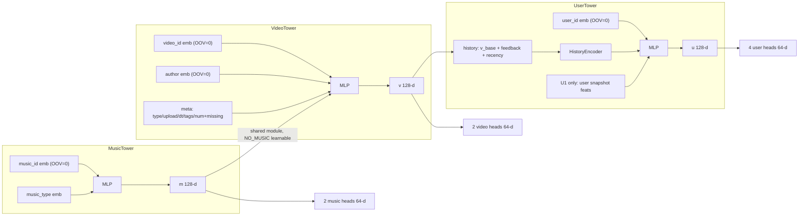
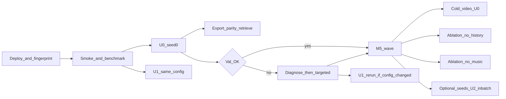

# D1：三塔 v1 架构设计（Revision 2，已批准 2026-10-11）

> 已批准。仓库为 private，服务器使用只读 Deploy Key。批准时新增的三项实施约束：
> - cold condition 的所有产物必须来自同一 condition，用 `condition_id` 校验；
> - GPU 运行固定 SHA，输出写到工作树之外，并及时备份；
> - 模型选择只用 validation。
>
> 具有约束力的摘要见 `PLAN.md` §3d（D1-5、D1-8、D1-11）。

## R2 变更记录（2026-10-11，依据用户对 Q1/Q8/同步方式的附加约束）

R2 不扩大实验范围，不改 P1/M3 协议，也不改 R1 的其余内容。

- **[R2-1] Q1**
  - 已定：主损失为 train-seen 全量 softmax，in-batch 对照不列为必做（第 9 节的可选列表里仍保留）。
  - 措辞依据：Assignment 要求的是 contrastive retrieval 目标，以及正确处理 batch 中的 duplicate positives 和 false negatives，并没有强制 in-batch 负采样。
  - 新增：FN 掩码的精确定义——同用户、同任务、其他的 train 正样本；以及 6 个手工 fixture 用例（F1-F6，见第 3 节）。
- **[R2-2] Q8**
  - 已定：固定延迟规则，D = 20 min，不使用 `play_time_ms`。
  - 新增：官方字段语义的核查结果与依据，并明确说明 D 是一个保守假设，**不是已被证明的反馈完成上界**；同时列出残余风险（第 2 节）。
  - 未达到 D 的事件只隐藏反馈，不改变历史事件集合。
- **[R2-3] 代码同步**
  - 私有 GitHub 是唯一的代码版本来源。服务器 clone 后检出固定的 commit SHA。
  - 认证首选仓库级只读 Deploy Key：密钥在服务器上新生成，**不接触个人 SSH 私钥**。
  - 认证受阻时，备用方案是 `git archive <SHA>` 加 rsync。
  - Raw data 单独同步（第 8 节）。

约束：以 Assignment 为最高优先级，P1（§3b）和 M3（§3c）原文不改。D1 只新增模型侧的决策，批准后写入 `PLAN.md` §3d。冷启动视频、bootstrap、分桶和消融的**实验**属于 M5；D1 只保证它们所需的开关和接口存在。

## R1 变更记录

整体架构（第 1 节）保持不变。

- **[R1-1] Q1 主损失改为 train-seen 全量 softmax**，不再使用 logQ。原因：去重后的 in-batch 列，其实际入选概率并不等于 train 频率，开启 oversampling 时偏差更大。原方案的校正没有经过验证，不应使用。去重 in-batch 降级为可选对照，只有在校正公式按实际采样过程推导并通过测试后才能使用。（第 3 节、Q1）
- **[R1-2] Q8 改为只看事件年龄的保守规则。** 原规则依据 `t_event + play_time_ms >= t_pred` 判定，但 `play_time_ms` 是事后才确定的最终值，用它做判定本身就会泄漏信息。新规则只用 t_pred − t_event 决定是否隐藏反馈，历史事件集合不变。（第 2 节、Q8）
- **[R1-3] 补齐训练稳定性配置**：τ、weight decay、梯度裁剪、NaN/Inf 快速失败、各种边界情况、oversampling 下的 epoch 定义。新增梯度测试和稳定性测试。（第 3b 节、第 7 节）
- **[R1-4] 收紧一致性要求**：Direct 和 Export 使用同样的 FP32 设置、catalog、掩码和 tie-break；top-K 必须严格一致，**删除“近似并列豁免”**；另加逐用户指标相等检查。（第 6 节）
- **[R1-5] 新增服务器部署、基准测试和并行计划**：删除“单次训练 < 15 min”的预估；不使用 DDP；新增数据指纹对照（第 8 节）。
- **[R1-6] 新增三个执行层级**：M4 必做、val 不达标时的针对性调整、可选改进；同时定义 M4 的最小完整交付。删除原来的“≤ 8 个 config 的必做网格”（第 9 节）。
- **[R1-7]** U1 的高基数字段采用最小计数阈值，并在报告中记录（第 5 节）。

## 0. 设计依据（已有事实）

- 目录规模：视频 7,583 个，音乐 7,201 个（非 0）。train vocab：user 25,734、video 7,529、author 6,477、music 7,151。
- train 中正样本事件 345,365 条，其中 like 18,771 条（约 1:18）。有 11,338 个训练目标的历史为空。
- 非 0 音乐几乎与视频一一对应，只有 112 个 music id 被多个视频共享。
- M2 接口：
  - `HistoryIndex.model_history(users, t_pred, 100)`：严格满足 t < t_pred，结果右对齐。
  - `gather()`、`seen_rows()`。
  - `fit_condition(..., exclude_video_ids)`。
  - vocab 编码：PAD=0、OOV=1、NO_MUSIC=2。
- M3 接口：`Scorer` 协议、`evaluate`、`build_frames`、`history_view`、`M.apply_mask`、`M.rank_topk`（稳定排序，按分数降序，同分时按行号升序）。

## 1. 架构（已认可，未改动）

- **塔结构**：每个塔是 MLP + LayerNorm，输出 128 维，不使用 BatchNorm。
- **投影头**：每个 Target × Action 一个 Linear(128→64)，后接 L2 归一化。训练时 logit = cos/τ；评分和导出直接用 cos。
- **共享 Music Tower**：Video Tower 调用同一个 `MusicTower` 模块，取该视频音乐的 128 维 base 作为输入。`music_id=0` 使用一个可学习的 NO_MUSIC 嵌入，它在 train 中出现过。
- **视频 metadata**：
  - 使用 `video_type`、`upload_type`、`upload_dt`、`music_type`，tag 取最多 3 个做均值池化，3 个数值字段用 z 分数并带 missing flag。
  - 不使用 `tab`、statistic 文件和 popularity。
- **消融开关**（只做 flag）：`video.use_music`、`video.use_author`、`user.use_history`。

## 2. User History

- 一个函数 `build_history_batch(hidx, users, t_pred, cfg)` 同时用于三处：
  - 训练：t_pred 取目标事件时间，`hidx` 只包含 train 事件。
  - val：t_pred = T_val。
  - test 和导出：t_pred = T_test，`hidx` 由 `history_view` 构建。
- 底层调用 `model_history(..., 100)`。**事件集合与 P1-2 完全一致**：严格 t < t_pred，同一时间戳的事件全部排除，长度上限 100。
- 每个 token 的组成：
  - 该视频的 `v_base`（Q3a，来自共享 Video Tower）
  - 反馈块：8 个二值字段，加上 play_ratio 分桶嵌入
  - `feedback_hidden` flag
  - recency 分桶嵌入：log 分桶的 t_pred − t_event
  - 位置嵌入
- 编码器：2 层 Transformer（d=128，4 头）+ 注意力池化。空历史的处理见第 3b 节。

### [R1-2 / R2-2] 反馈的时间可用性（Q8，已定）

- **字段语义核查的依据**（[R2-2]）：
  - **官方文档**（[kuairand.com](https://kuairand.com/) 中 log 字段表）：
    - `time_ms` 只写作 "The timestamp of this interaction in milliseconds"，没有说明它是曝光、开始播放还是结束播放的时刻。
    - `play_time_ms` 写作 "The user's view time"，这是该次交互的**最终累计值**。
    - like/follow/comment/forward/hate/profile_enter 都只是该次交互的二值结果，**没有各自的动作时间戳**。
    - `profile_stay_time` 和 `comment_stay_time` 同样是事后累计值（模型里也不使用）。
  - **真实数据（只读检查）**：
    1. 同一用户相邻两个事件中，时间间隔 ≥ 前一事件 play 的占 99.77%，≥ 后一事件 play 的占 99.41%。
    2. 两次播放都超过 3 s 的相邻事件中，间隔与 play 的差落在 1 s 以内的，在两种语义下都只有 0.01–0.02%。间隔超出 play 的部分，中位数约为 36 s。
    3. 原因是 KuaiRand-Pure 只保留了 7,583 个候选池视频的日志，**序列本身不完整**：两个相邻事件之间夹着大量被移除的交互，所以无法靠相邻时间间隔推断字段语义。
    4. 有 312 次 like 发生在 `play_time_ms = 0` 的事件上，说明反馈不一定伴随播放发生。
    5. 最大 `play_time_ms` 为 965 s，train 与全量数据相同。
  - **结论**：`time_ms` 的语义和各反馈信号的确定时刻都**无法验证**。
- **规则（已批准）**：令 age = t_pred − t_event。若 age < D，则隐藏该 token 的全部反馈字段（置零，包括 play_ratio），并令 `feedback_hidden = 1`。
  - 取 D = 20 min，即 1,200,000 ms，写入 config。D 只是一个**保守假设**：在“开始时刻”语义下，它覆盖观测到的最长播放（965 s）并留出余量；它**不是**已被证明的反馈完成上界。
  - 视频 ID、时间和 recency 照常保留，它们在 t_event 就已知。
  - 判定只读取 t_pred 和 t_event，**不读取 `play_time_ms`，也不读取任何标签**。
  - train、val、test 使用同一个函数。
- **影响**（真实数据）：
  - 训练：隐藏了 2.6% 的 token，42% 的训练目标至少有 1 个 token 被隐藏。被隐藏的正是最近的事件，这是主要代价。
  - 在 T_val / T_test：被隐藏的 token 只有几百个，可以忽略。
  - 由此带来的 train/test 分布差异需要在报告中说明。
- **残余风险**（无法完全证明安全，报告中必须明确披露）：
  1. `time_ms` 的语义未知。如果它是结束时刻或日志写入时刻，D 会偏保守，对结果无害；如果它是曝光时刻且用户长时间停留，D 仍然覆盖观测到的最长播放。
  2. 非播放类动作没有自己的时间戳。如果用户在超过 D 之后才回到该视频点赞、评论或关注，这些信号就会被提前看到。数据集无法排除这种情况。
  3. 二值标签可能是该次交互的最终状态（例如取消点赞之后的结果），无法验证。
  4. 影响量级的说明：在 T_val / T_test 这两个冻结时点，age < D 的 token 只有几百个；训练时更常见（2.6%）。即使风险成立，主要影响的也是训练和测试之间的一致性，而不是 test 时直接泄漏。
- 与 P1 的关系（已确认）：历史事件集合不变，未达到 D 的事件只隐藏可能尚未确定的反馈。这属于实现层面的补充，不算 P1-2 协议变更。D 不做调参，也不做敏感性网格，以免扩大范围。

## 3. Training / Loss（[R1-1] 修订）

- **样本流**：train 中任一 action 为正的事件，共 345,365 行。每行带 4 个任务掩码；两个 music 任务要求 music ≠ 0。
- **主损失：train-seen 全量 softmax**
  - 候选列：
    - video 任务：当前条件下 train vocab 中的全部视频（正常条件 7,529 个）。
    - music 任务：train vocab 中的全部非 0 音乐（7,151 个）。
  - 断言：每行的标签都在候选列中。
  - 对每个任务 (t,a)，对有效行计算 CE(cos/τ)。**不做 logQ**：这是对候选集的精确 softmax，不存在采样偏差。
  - **重复正样本**：候选列天然唯一。同一 batch 中多行指向同一物品时，它们共用同一列。共享同一音乐的视频，在 music 任务上落到同一列。
  - **同用户假负样本（Q7a，[R2-1] 精确定义）**：对行 r（用户 u，任务 (t,a)，标签列 y_r），若候选列 c ≠ y_r 且 c ∈ Pos_train(u, t, a)，则把该 logit 置为 −inf。
    - Pos_train(u, video, a)：u 在 train 中对 action a 为正的全部视频行。
    - Pos_train(u, music, a)：上述视频对应的非 0 音乐行。
    - 只看**同任务**：例如一个 long_view 正样本在 like 任务里仍然是负样本，除非它同时也是 like 正样本。
    - 这同时覆盖 batch 内同一用户的其他行，以及同一时间戳的多个正样本。
    - Pos_train 只来自 train 标签（冷启动条件下不含 H），只用于从损失中去掉负样本，从不作为特征，也不进入 val/test 的任何输入。
    - 它会用到同一用户在 train 中更晚时刻的正样本，这是标准做法：只影响训练时剔除哪些负样本，不影响评估的信息边界。报告中需写明。
  - 评估不受影响：val/test 仍在完整 metadata catalog 上评分（M3 frames）。train-unseen 物品只是不作为训练负样本，评分走内容路径。
  - **冷启动视频（M5）**：H 经 `fit_condition` 排除出 vocab，因此自动不出现在训练目标、历史和候选列中。评估帧仍由未移除 H 的数据生成（P1-9 不变）。
- **计算成本**：Q3a 已要求每一步对整个视频和音乐目录做一次前向（用于历史 token）。全量 softmax 只额外增加 4 个 [B, ~7.5k] 的矩阵乘和 CE；B=1024 时约 1.2 亿个 fp32 值的量级，在 A100 上可以忽略。CPU smoke 使用手造的小目录。
- **稳定性**：
  - 没有采样噪声，梯度就是目标函数的精确梯度，训练目标与全目录评估一致。
  - 风险是热门物品主导负样本梯度，由 τ 和 weight decay 控制。
- **与 Assignment 的关系**：
  - 这是 contrastive retrieval 目标（InfoNCE，负样本为全部 train-seen 物品）。
  - 原文要求“Handle duplicate positives and false negatives in the batch”。在全量 softmax 下，batch 内的重复正样本表现为共享同一列，batch 内的假负样本由 FN 掩码处理；两者都有测试，并在报告中说明。
  - [R2-1] 已定：Assignment 要求的是 contrastive retrieval 目标，以及正确处理 batch 中的 duplicate positives 和 false negatives，没有强制 in-batch 负采样。报告用一段话说明这一选择。
- **可选对照：去重 in-batch**（不属于 M4 必做）
  - 与主损失共用掩码代码，只是列集合不同。
  - 只有在入选概率按实际 batch 构造方式精确推导时，才允许做校正。我们按 epoch 打乱、不放回抽取 B 行；含 oversampling 展开时，π_c = 1 − C(N−n_c, B)/C(N, B)，其中 n_c 是展开后列表中指向 c 的行数。校正需要 Monte Carlo 测试验证。
  - 若做不到，就以“未校正”的标签报告。
- **Action 平衡（Q6）**：
  - 每个任务在本任务的有效行上取均值，总损失 L = Σ L_{t,a}，四项等权。
  - 主模型 `like_oversample = 1`。B=1024 时，每个 batch 约有 56 行 like。
  - **oversampling 的语义（k > 1 时）**：
    - 每个 like 行额外复制 k−1 份。复制行只开启两个 like 任务的掩码，两个 long_view 任务关闭，因此 long_view 的样本分布不变。
    - 一个 epoch = 展开后列表的一次随机排列。日志同时记录 step 数和各任务有效行数。
    - k 仅作为针对性调整（第 9 节）。

## 3b. [R1-3] 训练稳定性配置

- **τ**：固定 0.05，基于 64 维 L2 归一化的 cos。只有在出现针对性问题时才尝试 {0.03, 0.1}。
- **优化器**：AdamW，lr 1e-3，前 300 步线性 warmup，之后恒定。
  - Linear/Transformer 权重的 weight decay = 0.01；embedding、bias、LayerNorm 为 0，避免解耦衰减不断收缩不在 batch 中的用户行。
  - 梯度裁剪：clip_grad_norm = 1.0。
- **batch 与 epoch**：
  - batch 默认 1024。全量 softmax 下 batch 大小不影响负样本数，所以 batch 小一点、更新次数多一点更合适；最终以基准测试为准。
  - 最多 30 个 epoch。每个 epoch 在 val masked 上评估一次（Q9a），patience = 3。
- **ID dropout**：video、author、music、user 的 ID 槽各自独立以 p = 0.1 置零。物品侧在每一步的目录前向中做一次采样，候选列和历史 token 共用这一次结果。
- **精度**：FP32 训练，TF32 默认关闭；只有基准测试证明有必要时才开启，并记录在案。导出和 Direct 评分一律使用 FP32 且关闭 TF32。
- **NaN/Inf 快速失败**：
  - 每一步检查 loss 和 grad norm 是否为有限值。
  - 一旦异常，立即报错，并把 step、batch 行号、各任务 loss 保存到 `debug/`。**不静默跳过**。
- **边界情况**：
  - **空历史**：先把 key 掩码中的一个位置解除掩码，避免全掩码注意力输出 NaN；再把池化输出乘以 (len > 0)。必须在乘法之前就保证没有 NaN，因为 NaN × 0 仍是 NaN。
  - **某任务在 batch 中没有有效行**（例如没有 like 正样本）：这一项不参与计算，不会出现 0/0。
  - **FN 掩码后只剩标签列**：CE = 0，仍是有限值。
  - **OOV 用户 + 空历史**（全零 ID 输入）：结果有限。这条路径由 ID dropout 和空历史训练目标训练过。
  - −inf 只用于非标签列，并断言标签 logit 有限。

## 4. OOV / Cold-video

- **固定零行（Q5b）**：所有 embedding 表的 PAD 行和 OOV 行在初始化时置零，前向时再乘以一个常量 buffer 掩码。因此这两行的梯度恒为 0，Adam 更新也为 0；embedding 的 weight decay 为 0。NO_MUSIC 是可学习的。
- OOV 物品的分数只取决于训练过的内容参数。三塔的 `item_scorable` 全部为 True，`gt_unscorable` = 0。
- 冷启动用户（无历史，必然是 train-OOV）的 embedding 来自训练过的空历史 + 零 ID 路径。他们按 P1-1 单独报告。
- 冷启动视频：见第 3 节，入口为 `exclude_video_ids` → `fit_condition`。

## 5. User Metadata（[R1-7] 补充）

- **U0（主模型）**：ID + 历史。
- **U1（必做：实现、训练、评估）**：
  - 在 U0 基础上加入 `onehot_feat0..17`（NaN 单独一类）、`is_live_streamer`（−124 单独一类）、`is_video_author`、`register_days_range`。
  - 每个字段 16 维嵌入。vocab 只在有 train 事件的用户上拟合。出现次数少于 5 个 train 用户的取值，以及未见过的取值，统一映射到固定零行。
  - **可比协议**：直接使用 U0 选定的配置、seed、早停规则和帧，**不单独调参**。如果 U0 的配置后来改了，U1 也要重跑。
- **需记录的风险**：
  - Snapshot 泄漏风险沿用 P1-8 的说明，主表和结论都用 U0。
  - `onehot_feat3`（1,471 个取值）和 `feat8`（454 个取值）接近用户 ID 的粒度，可能充当 train-OOV 用户的 ID 代理。报告需写明阈值后保留的取值数，以及 U1 对 OOV 用户和 in-vocab 用户各自的影响。
- **U2（可选）**：在 U1 基础上用同一个 flag 打开更多字段，仅在时间允许时运行。

## 6. Evaluation / Export / retrieve()（[R1-4] 修订）

- **导出**：
  - 写到 `runs/threetower/<exp>/<run_id>/export/`。
  - 内容：
    - 每个 (target, action) 的物品矩阵 [n_catalog, 64]，覆盖全部 catalog 行（含 OOV 物品）。
    - T_val 和 T_test 两个时点的用户矩阵。
    - `user_ids` 和各 catalog 的 id 列表。
    - T_test 的 seen 掩码 CSR。
    - `manifest.json`：git sha、config hash、checkpoint sha256、t_pred、frame_id、数据指纹。
- **统一推理设置**：eval 模式（不做 ID dropout），FP32，关闭 TF32，开启 deterministic，使用同一份 catalog 行映射、同一个 M2 掩码和同一个 `rank_topk`。
- **报告指标全部来自 `ExportedScorer`**：读取导出文件，用 numpy float32 计算 U @ I.T。
- **`DirectScorer`**：在独立进程中重新加载 checkpoint，用 `load_processed` 从原始 id 重建特征，做模型前向，再用 torch 计算 cos。它用于训练中的 val 评估和一致性校验。
- **公平性**：
  - 复用 `build_frames`，并断言 frame_id 与 `results/baselines/frames_summary.json` 一致。
  - 输出与 M3 同格式的 per-user parquet。
  - 冷用户帧单独报告。
- **`retrieve(user_id, target, action, k, mask_seen=True)`**：
  - 与 `ExportedScorer` 共用同一个打分函数和 `M.apply_mask` + `M.rank_topk`。
  - 未知 user_id 直接报错。
- **一致性检查（全部严格执行）**：
  1. **Direct vs Export 分数**：抽 ≥ 2,048 个用户（必须包含 train-OOV、1-5 / 6-20 / >20 历史长度、冷用户），在 4 个任务的**全部 catalog 行**上要求 max |Δ| ≤ 1e-5。报告 max 和 p99 的 |Δ|。
  2. **Direct vs Export top-50 严格一致**：顺序完全相同，不设近似并列豁免。若出现差异，检查失败，并输出 (user, task, rank, 两侧分数, 分差, 同分边界)。先定位原因，再与用户商定处理方式。
  3. **`retrieve()` vs `ExportedScorer`**：分数 bitwise 相等，top-K 相等（两者走同一个函数）。retrieve 的掩码与 frame 中的掩码 CSR 逐用户相等。`mask_seen=False` 时返回的结果包含 seen 物品。
  4. **指标级检查**：对 val 和 test 的 masked 帧，`DirectScorer` 和 `ExportedScorer` 的 per-user 指标必须逐行相等；有任何差异都报告。

## 7. 模块与测试（[R1-3] 补充）

新增模块 `src/kuairand_rec/models/`：
- `features.py`
- `towers.py`
- `loss.py`
- `data.py`：样本流、oversampling 展开、Pos_train
- `train.py`：CLI，含 `--max_steps` 和 `--benchmark`
- `export.py`

新增 `scripts/data_fingerprint.py`（见第 8 节）。

新增配置：`configs/threetower_smoke.yaml`、`threetower_u0.yaml`、`threetower_u1.yaml`。

测试全部使用手造的小数据，CPU 上总时长 < 60 s：
- **泄漏（L1-L5）**：
  - L1：所有 token 时间都 < t_pred，同一时间戳的事件被排除，长度上限 100，三种 t_pred 都成立。
  - L2：age < D 时反馈被隐藏，age == D 时反馈可见。
  - L3：修改被隐藏 token 的 `play_time_ms` 和标签，输入张量 bitwise 不变。这说明判定逻辑不读取最终播放时长。
  - L4：修改任意 t ≥ t_pred 事件的任意字段，输入张量 bitwise 不变。
  - L5：T_test 时，age < D 的 val 事件被隐藏。
- **掩码与损失**（[R2-1]，手工 fixture F1-F6，约 3 个用户、5 个视频、4 个音乐，其中一个音乐被两个视频共享）：
  - F1：同一 batch 中两行（同一用户，或不同用户）的标签是同一物品，两行的标签指向同一列，该列只出现一次。
  - F2：用户 u 在 train 中有 lv 正样本 {A, B, C}。标签为 A 的行中，B、C 为 −inf，A 保持有限；其他用户行的 B、C 不受影响。
  - F3：只看同任务。A 是 u 的 lv 正样本但不是 like 正样本时，在 u 的 like 行中 A **不被**掩码。
  - F4：共享音乐。视频 V1、V2 使用同一音乐 M：music 任务里两者的标签都落在 M 列；video 任务里 V2 不是 u 的正样本时，在 V1 行中**不被**掩码。
  - F5：music 为 0 的行不产生 music loss；FN 掩码后只剩标签列时 CE = 0。
  - F6：loss 数值等于手算的 −log softmax（只在未被掩码的列上计算）。候选列 = 当前条件下的 train vocab；冷启动条件下候选列和 Pos_train 都不含 H。
- **梯度**：
  - 四个任务分别单独反传时，该任务的 user 头和 item 头梯度都是有限非零值，其他任务的头梯度为 0。
  - 只用 video loss 时，Music Tower 参数的梯度非零；`use_music=False` 时为零。
- **稳定性**：
  - 空历史、batch 中没有 like 行、FN 掩码后只剩标签列、OOV 用户 + 空历史这几种情况下，loss 和梯度都是有限值。
  - 注入 NaN 时会快速失败。
- **OOV**：
  - 多次 optimizer step 之后，OOV/PAD 行仍严格为 0。
  - 修改这些行的原始值，分数不变。
  - OOV 物品的分数是有限值。
- **Oversampling**：k = 4 时，展开后的行数和各任务有效行数与公式一致，复制行的 long_view 掩码关闭。
- **导出**：在 fixture 上执行第 6 节的检查 1-4。
- **Smoke**：
  - fixture 上训练 2 个 epoch，loss 下降，评估、导出和一致性检查全部通过。
  - 真实数据上的 CPU 命令：`--max_steps 5`。

可复现性：
- 设置 seed（python / numpy / torch），设置 `CUBLAS_WORKSPACE_CONFIG`，开启 deterministic。
- 每个运行目录记录 config、git sha、数据指纹、frame_id 和 checkpoint sha256。

## 8. [R1-5] 服务器、基准测试与并行

### 最小部署步骤
1. **代码同步**（[R2-3]，私有 GitHub 是唯一的代码版本来源）：
   - 现状：remote `origin` 指向 `github.com/yangbright-2001/Kuairand-3tower-Recommender`，`main` 已与 origin 同步（`730e643`，内容到 M3 为止），未提交的只有 D1 plan。**需要你确认该仓库是 private。**
   - Mac 端：M4 的代码按逻辑单元 commit，只在你授权时用你 Mac 上已有的 git 凭据 push。我不读取、不复制、不转发任何个人密钥。
   - 服务器认证（首选只读 Deploy Key）：
     - 在服务器上新生成一个专用密钥：`ssh-keygen -t ed25519 -f ~/.ssh/kuairand_deploy -N ""`。
     - 由你把公钥添加到该仓库的 Deploy keys，**不勾选 write access**。
     - 在 `~/.ssh/config` 中为它配置一个 Host 别名（`IdentitiesOnly yes`），只作用于这个仓库。
     - 不使用 agent forwarding，不复制 Mac 上的私钥。
     - 备选：fine-grained PAT，只授权这一个仓库的 Contents 只读权限，设短有效期；通过交互输入，不写入仓库、shell history 或 config。
   - 检出：`git clone` 后执行 `git checkout --detach <SHA>`。每次正式运行都在 `run_meta.json` 中记录 `git rev-parse HEAD`，并要求 `git status --porcelain` 为空，否则拒绝运行。
   - 如果认证受阻：先报告问题，然后改用备用方案——在 Mac 上执行 `git archive <SHA> | gzip`，rsync 到服务器解压；同时写入 `GIT_SHA` 文件，并核对压缩包的 sha256。运行时记录这个 SHA，并标注“archive 部署”。
   - 非代码文件不进 git：`data/`、`runs/`、`.venv/`、密钥。
2. **环境**：服务器上执行 `uv sync --frozen`，再运行 `uv run python -c "import torch; print(torch.cuda.is_available(), torch.version.cuda)"` 确认 CUDA 可用；检查 `implicit` 能否导入；跑一遍 `uv run pytest`。
3. **原始数据（单独同步，不经过 git）**：
   - 在服务器上执行 `wget https://zenodo.org/records/10439422/files/KuaiRand-Pure.tar.gz`，下载到 `/local-scratch/liang/`。
   - 核对官方 md5：`0820331067a3784d9691136f772b35a7`（来自 kuairand.com）。
   - 解压后，把实际用到的 4 个 CSV 的 md5 与 Mac 上的对照。
   - 如果服务器不能访问 Zenodo，就从 Mac 用 rsync 同步 `data/raw/KuaiRand-Pure/`，然后做同样的 md5 核对。
   - Raw data 在服务器上同样只读，不修改。
4. **重跑 M2 pipeline**，然后运行 `scripts/data_fingerprint.py`。对每个 parquet 输出：
   - schema：列名和 dtype
   - 行数
   - 规范化内容 hash：按主键排序，整数列和字符串列按列做 `hash_pandas_object`；浮点列先四舍五入到 1e-9 再 hash，并报告 max |Δ|
   - 文件 md5（作为参考）

   在 Mac 和服务器上各生成一个 JSON，用 diff 比较。另外在服务器上只构建 frames（不跑 ALS），核对 frame_id 与 `frames_summary.json` 一致。
5. **调度方式**：用 `sinfo` 或 `sbatch --test-only` 确认 Slurm 是否可用。优先使用 Slurm；不可用时，用 `CUDA_VISIBLE_DEVICES` + tmux/nohup，每个任务单独写日志。

### 单 GPU smoke 与基准测试
- 先运行 `train --config threetower_u0.yaml --max_steps 50` 做 smoke，再用 `--benchmark --max_steps 300` 测量：
  - 每步耗时及其中数据和计算的占比
  - 每个 epoch 耗时
  - 一次 val 评估的耗时
  - 峰值显存 `max_memory_allocated`
  - GPU 利用率
- 结果写入 `results/threetower/benchmark.json`。**不预设单次训练时长。**

### 基准测试后的决策规则
- 估算 T_run 上界 = 30 × (epoch 耗时 + val 评估耗时)。
  - 若 ≤ 2 h，按下面的波次计划执行。
  - 若 > 2 h，先用 U0 的 val 曲线决定 max_epochs 或 batch，并告知用户，然后再启动 U1 和 M5 波次。
- 若峰值显存 < 35 GB 且利用率 < 50%，允许一张卡同时跑 2 个任务，否则每卡 1 个。
- 不使用 DDP：每个任务都是独立进程。

### 依赖与波次

- **波次 1**（基准测试之后）：U0 和 U1 在两张卡上并行。U1 使用与 U0 相同的 v1 配置。
- **波次 2**（U0 配置确认之后）：冷启动视频 U0、无历史消融、无音乐消融，3 张卡并行。冷启动条件下的 Pop/ALS 基线在 CPU 上运行（M5）。
- 空闲的卡用于可选实验。
- **路径**：
  - 每个实验一个目录 `runs/threetower/<exp>/<run_id>/`，内含 config、ckpt、export、logs、debug。
  - 小体积结果写到 `results/threetower/<exp>/`。
  - exp 名称包括 `u0`、`u1`、`cold_u0`、`abl_nohist`、`abl_nomusic`、`tune_*`、`seed*`。

## 9. [R1-6] 执行层级与 M4 交付标准

### M4 必做（完整 v1，不缩水）
- 第 1-7 节的全部内容：全量 softmax、FN 掩码、按任务取均值、τ = 0.05、2 层 Transformer、共享 Music Tower、固定零 OOV 行、Q8 规则。
- 所有测试通过，CPU smoke 通过。
- **M4 最小完整交付**：
  1. U0（seed 0）在真实数据上训练，并按 val 早停。
  2. 导出完成；4 个任务在 masked、nomask、冷用户三种帧上都经 shared evaluator 用 `ExportedScorer` 评估，frame_id 与 M3 一致。
  3. 在真实数据上第 6 节的一致性检查 1-4 全部通过，`retrieve()` 有可运行的示例。
  4. U1 在同一协议下完成训练和评估。
  5. 写出 `metrics.csv`、per-user parquet、`run_meta.json` 和 `benchmark.json`。

### 针对性调整（只在 val 不达标时）
- **触发条件**：U0 在 val masked R@20 上，任一任务低于 Pop，或在 long_view 任务上明显低于 ALS。
- **先诊断，不先加复杂度**：
  - 看各任务 loss 曲线，确认 train loss 收敛
  - 看各塔 grad norm
  - 看 FN 掩码的比例
  - 看训练集上标签的排名
  - 在小子集上检查能否过拟合
  - 检查 embedding 是否塌缩（范数和 cos 分布）
- **然后按顺序调整，每次一项**，全部只在 val 上选择，总预算 ≤ 7 个额外 config（与 ALS 的 8 点网格相当）：
  1. τ ∈ {0.03, 0.1}
  2. lr
  3. `like_oversample = 4`（仅在 like 任务表现差时）
  4. 把均值池化作为诊断对照（只用于判断 Transformer 是否有问题，不替换主模型）
- 每次调整都记录在 `results/threetower/tuning.csv`。

### 可选改进（M5 必做项完成之后，时间允许时）
- seeds {1, 2}
- U2
- 去重 in-batch 对照（校正需按第 3 节验证）
- Q2c 随机延迟训练
- 冷启动条件下的无音乐 / 无作者消融

### 其余决策（R1 批准状态）
- Q2a、Q3a、Q4a、Q5b、Q7a、Q9a、Q10：原则上已批准，内容不变。
- Q6：保留。oversampling 只作为针对性调整，采样逻辑按第 3 节执行，并有测试。

## 10. 决策状态

已批准（2026-10-11，含附加约束，见 R2）：
- Q1：主损失为 train-seen 全量 softmax，带同用户、同任务的 FN 掩码，并用 fixture F1-F6 验证；in-batch 对照不是必做。
- Q8：固定延迟规则，按事件年龄 D = 20 min 判定，不使用 `play_time_ms`；D 是保守假设，残余风险需披露；历史事件集合不变。
- 代码同步：私有 GitHub，服务器检出固定 SHA，认证首选只读 Deploy Key，受阻时用 archive + rsync 备用；raw data 单独同步。

R2 仍需你确认的事项：
1. `Kuairand-3tower-Recommender` 是否为 private 仓库。
2. 是否由你在 GitHub 上添加只读 Deploy Key（公钥由我在服务器上生成后交给你），或改用 fine-grained PAT。
3. 整份 D1（R2）批准后，我会把 D1 决策写入 `PLAN.md` §3d 并更新 `PROGRESS.md`，然后开始 M4。

（以下是 R1 时的原始选项，保留作为记录）

1. **Q1 主损失**
   - 推荐：train-seen 全量 softmax，不做 logQ。in-batch 只作为可选对照，不属于 M4 必做。
   - 需要你确认：Assignment 中“in the batch”的措辞，由“batch 内重复正样本共享同一列 + FN 掩码”的测试和报告说明覆盖，是否可以接受？还是要求把 in-batch 对照也列为必做？
2. **Q8 反馈可用性**
   - 推荐：按年龄判定，D = 20 min（训练时隐藏 2.6% 的 token）。
   - 备选：不做任何隐藏，只在报告中披露。最多涉及 0.3% 的训练目标，以及 T_test 时的 2 个 token；但原判定规则本身依赖未来才确定的值。
   - 另需你确认：这属于实现层面的补充，不算 P1-2 协议变更。
3. **代码同步**：GitHub 私有仓库（需要你先创建 remote，或授权我执行 commit 和 push）还是临时 rsync。

## 11. 不在 D1/M4 范围内

- bootstrap、分桶、冷启动和消融实验的运行（M5）
- Protocol B
- 把曝光未点击作为困难负样本
- popularity 特征
- DDP
