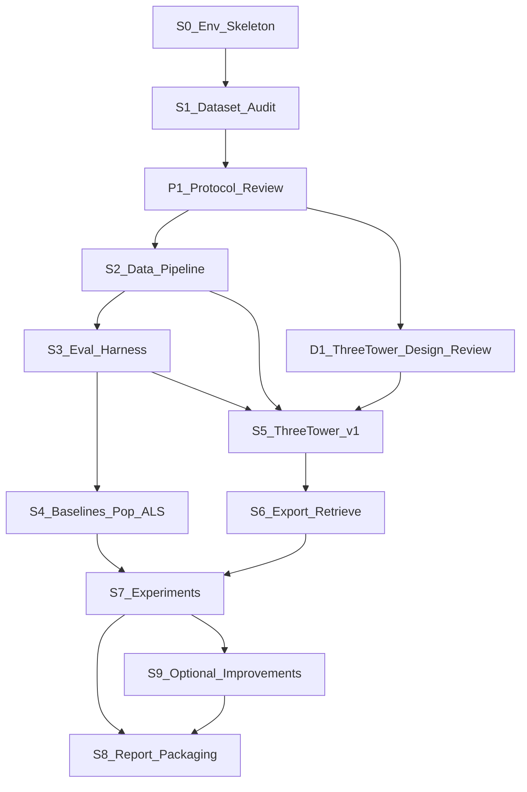

# KuaiRand-Pure 三塔召回：开发工作流提案（讨论稿）

> 本文是提案而非已定决策。标注"倾向"的条目仍需讨论确认。
>
> 修订 v2（10/11 00:38 PT）：根据用户反馈更新了服务器与环境信息、random log 定位、评估协议（保持开放）、music 重复正样本（保持开放）、三塔设计评审时点、M3 验收标准、Audit 阶段 A 范围，以及切点判断。

## 已确认的协作约定

- 分工：
  - Agent 负责主要实现、测试、调试和实验执行。
  - 用户深度参与关键方案讨论，并审核设计、协议、结果和解释。
- 必须先征求用户确认的决策：
  - 实质影响实验正确性的决策（切分、协议、正样本、catalog/mask、泄漏）
  - 模型架构与 loss
  - 结果解释
  - 每次都要说明假设、备选方案和取舍。
- 普通实现细节由 Agent 自主处理。
- 质量目标：
  - 构建一个正确、完整、有合理竞争力的三塔模型，不做为赶时间而刻意简化的 toy 方案。
  - 先完成一版设计合理、经过验证的系统，再根据剩余时间探索架构或 loss 的改进。
  - 不强求超过 ALS，但模型设计、训练和分析都要认真对待。

## 0. 现状快照（只读观察到的事实）

- 时间：现在是 10/11（周日）00:16 PT，截止时间是 10/12（周一）EOD PT，约 47 小时，其中要扣除睡眠。必须优先保证一个正确的端到端系统。
- 原始数据已在本地 [data/raw/KuaiRand-Pure/data/](data/raw/KuaiRand-Pure/data/)：
  - `log_standard_4_08_to_4_21_pure.csv`：约 114.1 万行，14 天。
  - `log_standard_4_22_to_5_08_pure.csv`：约 29.5 万行，17 天。
  - 两个文件合计约 143.7 万行，第一个文件约占 79.4%。按全局时间排序后的记录数做 70/15/15 切分（仅按行数粗估）：
    - 70% 切点落在第一个文件内，85% 切点落在第二个文件内。
    - Phase A 实测：日交互量集中在 4/10-4/12，所以切点比按均匀分布估计的更早。70% 切点约在 4/16 22:07，85% 切点约在 4/25 21:38（Asia/Shanghai）。
    - 因此 val 跨越两个文件，test 完全落在第二个文件内。第二个文件的日均量明显更低，所以 val/test 在时间上较长、密度较低。这可能影响 val/test 的用户覆盖和分布，需要在 audit 中检查。
    - 最终切点必须在 Dataset Audit 中用实际 `time_ms` 计算，并明确处理切点处的相同时间戳。
  - `log_random_4_22_to_5_08_pure.csv`：约 119 万行，`is_rand=1`。初期主实验不使用，Audit 阶段 A 也不读取。
  - `user_features_pure.csv`：27,285 个用户，单一快照。`is_live_streamer` 中出现了 `-124` 这样的哨兵值。
  - `video_features_basic_pure.csv`：7,583 个视频，包含 `author_id`、`music_id`、`music_type`、`tag`、`upload_dt`、`visible_status`。
  - `video_features_statistic_pure.csv`：**禁止作为模型特征**（会泄漏未来信息）。Audit 阶段 A 也暂不读取。
- 日志字段：`time_ms`、`date`、`hourmin`、`is_click`、`is_like`、`long_view`、`play_time_ms`、`duration_ms`、`tab` 等。
- 本地环境：Homebrew Python 3.13 加 conda，本地尚未安装 uv，也没有 pandas/torch/implicit。仓库是空骨架。
- GPU 服务器（来自 Onboarding README）：
  - 硬件：DGX A100，8×A100 80GB，256 线程，2TB RAM。
  - 系统：Ubuntu 24.04，CUDA 13.0，Driver 580，系统 Python 3.12.3，已装 uv 和 Slurm。
  - 连接：公网 SSH，别名 `gpu228-liang`。
  - 存储：大文件放在 `/local-scratch/liang/`。该目录**没有自动备份**。
  - 公网下载可用。从 Zenodo 下载尚未验证，从 Mac 发起的 SSH 也尚未验证。
- 推论：数据规模小（约 1.44M 条交互，约 7.6k 个视频）。全量训练在 M1 上也可行。A100 的价值在于**并行吞吐**（多 seed、消融、冷启动重训、小规模调参），而不是可行性。

## 1. 开发阶段与依赖

- S0 环境与骨架：包结构、配置系统（YAML + dataclass）、全局 seed、pytest、`.gitignore`（数据和产物）、CPU smoke test 入口。
- S1 Dataset Audit：详见第 6 节。它为 S2 的所有决策提供证据。
- P1 协议评审（用户确认点）：Audit 完成后，逐项讨论以下问题的方案、优缺点和取舍，经用户确认后写入 PLAN.md：
  - 评估协议：frozen 还是 rolling history，per-user-set 还是 per-event 评估。
  - 训练和评估中的重复正样本处理，包括 music。
  - catalog 定义与 mask 规则。
  - 过滤规则。
- D1 三塔 v1 设计评审（用户确认点）：在 Audit 和 P1 之后、首次实现与训练之前，确定第一版的以下内容：
  - 塔结构和历史编码器
  - music、author 如何融入 video 塔
  - 对比 loss
  - 重复正样本和假负样本的处理
  - 行为平衡策略
  - 在 PLAN.md 中记录备选方案和理由。
- S2 数据管线，包含：
  - 时间切分
  - 两种行为的正样本定义
  - video/music catalog
  - 严格过去的历史序列（最多 100 条）
  - 仅基于 train 的 popularity
  - 冷启动视频 holdout 的钩子
- S3 评估框架：所有模型（Pop、ALS、三塔）共用**同一个**全目录评估器，覆盖：
  - Recall/NDCG@{10,20,50}
  - 被评估用户数，以及被排除或 OOC 的正样本数
  - 历史长度分桶
  - 用户级配对 bootstrap
- S4 基线：Popularity 和 implicit ALS，覆盖 user-video 和 user-music。神经模型出现之前，先用它们验证评估框架。
- S5 三塔 v1：按 D1 确认的设计实现。它应是设计合理、具备竞争力的版本，不是为赶时间而刻意简化的 toy 方案。
- S6 导出与 `retrieve(user_id, target, action, k)`：基于导出的 embedding 和 ID 映射，并做导出分数与模型直接打分一致的校验。
- S7 实验：
  - 主对比加 bootstrap CI
  - 历史长度分桶
  - 受控冷启动视频实验
  - 至少一个消融
- S8 报告（5-8 页）与产物打包：代码、配置、checkpoint、embedding、结果、agent 日志。
- S9 可选改进：只在 S8 已有完整初稿之后进行。

关键路径是 S0 → S1 → P1 → S2 → S3 → S5 → S6 → S7 → S8。

- D1 可以在 S2/S3 实现期间同步讨论，从而不阻塞关键路径。
- S3 完成后，S4 可以与 S5 并行。

## 2. 核心技术挑战与正确性风险

### 2.1 时间正确性与泄漏
- 切分语义：倾向按 `time_ms` 分位数做**全局**时间切分，而不是按用户切分。需要规定切点处时间戳相同时如何归属。
- "严格早于预测时刻"：
  - 相同 `time_ms` 的事件不能互相进入对方的历史。
  - 需要决定 val/test 的历史是**滚动**（包含更早的 val/test 事件）还是**冻结**在 train 截止点。这是核心协议决策。
- 历史里放什么：放全部曝光/观看事件，还是只放正反馈（long_view/like）？这会影响历史长度分桶的含义，需要 audit 数据支撑。
- 统计文件之外的泄漏：
  - `user_features` 是单一快照，粉丝数、关注数等可能反映未来。
  - `video_features_basic` 的 `visible_status`、`upload_dt` 也可能有泄漏。
  - 需要逐列评审，结论分为保留、丢弃或标记。
- 所有拟合类统计都只能用 train：popularity、ALS、特征归一化、词表。

### 2.2 标签与目标
- `long_view` 的定义：需要检查它与 `play_time_ms/duration_ms` 是否一致。`is_like` 极稀疏，两种行为严重不平衡。
- music 目标由视频正样本派生。多个视频共享一个 `music_id`，所以同一用户可能多次对同一 music 产生正反馈。
  - **如何处理这些重复的 music 正样本是开放的研究设计问题，不预先确定去重策略。**
  - 需要在 Audit 后，结合以下因素讨论训练和评估中各自的处理方式：
    - 实际的 music ID 分布
    - 重复交互的程度
    - 选定的对比 loss
    - 选定的评估协议
  - 候选方案包括：保留重复作为加权信号、按某种粒度合并、训练与评估采用不同口径等。
  - `music_id` 可能缺失或是哨兵值。
- 同一 (user, video) 的重复交互同样是开放问题，训练口径和评估口径可能不同。

### 2.3 对比学习陷阱（第一版机制在 D1 评审中确定，后续可根据实验迭代）
- batch 内重复正样本：同一视频，或者共享同一 music 的不同视频，会被互相当作负样本。music 侧的碰撞远比 video 侧严重。
- 假负样本：batch 内的"负样本"其实是该用户在 train 中的其他正样本。
- in-batch 采样带来流行度偏置，logQ 校正是候选方案。
- 两种行为的平衡（like 远少于 long view），候选方案包括：
  - loss 加权
  - 按行为分别采样或分别建 batch
  - 温度和权重的选择
- 作业要求必须在报告中解释平衡方式。

### 2.4 评估陷阱
- catalog 定义：是元数据中的全部视频，还是 train 中出现过的视频？OOC 的正样本要**计数并排除**，不能静默丢弃。
- 是否屏蔽用户在 train 中看过的物品：取决于 audit 得到的复看率。无论怎么选，所有模型都必须一致执行。
- 指标定义：
  - Recall@K 的分母是 `|pos|` 还是 `min(K,|pos|)`，需要明确。
  - NDCG 用二值相关性，IDCG 要算对。
  - 在产生任何结果之前，先用手算样例做单测。
- 零历史用户如何处理，以及它与 1-5 / 6-20 / >20 分桶的关系。
- Bootstrap：按用户重采样，跨模型配对，固定 seed 和重采样次数。
- 冷启动视频：
  - held-out 视频必须从训练交互、历史 ID 查表、ID embedding 训练中全部移除。
  - 测试时只用 metadata、music、author 编码。
  - 评估方式待定：在全目录中评估、只在冷视频子集上评估，或两者都报告。
- 分数一致性：导出 embedding 的点积必须与模型 forward 的分数在容差内一致。注意不要出现只在一条路径上做了 normalize 或温度缩放的情况。

## 3. 本地 M1 与远程 8×A100 的分工

- **本地 M1（主开发循环）**：
  - Audit、数据管线、全部测试、评估框架
  - Pop/ALS（这个规模 CPU 足够）
  - CPU smoke test（子采样数据、1 个 epoch，2 分钟以内）
  - `retrieve()` 接口
  - 三塔的调试级训练
- **远程 A100（吞吐）**：
  - 主实验多 seed
  - 冷启动重训、消融、小规模超参扫描
  - 倾向**一卡一个 run**，用配置文件并行启动多个任务，不做 DDP，避免增加复杂度。
  - 调度方式在 M0 验证服务器时确定：Slurm 提交，或者直接 `CUDA_VISIBLE_DEVICES` 加 tmux/nohup。
- **同步方式**：
  - 代码：GitHub，本地 push，服务器 pull。
  - 工作目录：服务器上的代码和数据放在 `/local-scratch/liang/`。
  - 原始数据：优先在服务器上直接从 Zenodo 下载（需验证），失败则从 Mac rsync。两端都做 sha256 校验。
  - 处理后的数据：两端用同一命令确定性地重新生成。
  - 产物：放在 `artifacts/<run_id>/`（gitignore）。服务器没有自动备份，所以重要产物（checkpoint、embedding、结果）要**及时** rsync 回本地。
- **可复现性保障**：
  - **uv + Python 3.12**，本地和服务器统一，使用 `pyproject.toml` 加 `uv.lock`。服务器系统 Python 是 3.12.3。
  - 本地需要先安装 uv。遇到兼容性问题再调整，主要风险是 `implicit` 和 PyTorch 的 CUDA 13 wheel。
  - 每个 run 目录保存 config、git SHA 和 seed。
  - 做一次小规模的 CPU 与 GPU 一致性检查。
- **绝不**把 OpenRouter key 放进仓库或服务器上的项目目录。

## 4. 现在可定与需推迟的决策

### 4.1 现在可以定（流程与不变量）
- 仓库结构、配置格式、run 目录约定、产物 gitignore。
- 合并两个 standard 日志后做全局时间切分。
- random 日志不进入主实验。完成核心任务后如果还有时间，再讨论它是否适合做额外分析，且不假设它能提供完全无偏的评估。
- 环境：uv + Python 3.12。
- 报告用 Markdown 编写，导出 5-8 页 PDF。
- 交付方式：代码和小型结果放 GitHub；模型权重、embedding 等大型产物放 Google Drive。具体交付结构以后再定。
- 禁用统计文件，所有流行度和统计量都来自 train。
- 所有模型共用一个评估器，使用用户级配对 bootstrap。
- 对指标、切分/泄漏、历史 mask、分数一致性先写测试再依赖结果。
- 历史上限 100，严格早于预测时刻（同时间戳排除）。

### 4.2 Audit 之后再定（在 P1 协议评审中逐项与用户讨论确认）
- 切点时间戳与同时间戳的归属规则。
- **评估协议**：frozen 还是 rolling history，per-user-set 还是 per-event 评估。
  - 需要结合以下因素详细对比各方案的优缺点，**由用户确认，不默认选定**：
    - 数据特点
    - 时间泄漏
    - 全目录评估
    - 模型间公平比较
    - embedding 导出与 `retrieve()` 的要求
- 历史序列包含哪些事件（全部曝光还是仅正反馈）。
- catalog 定义、OOC 处理、是否屏蔽 train 中看过的物品。
- 正样本定义，以及训练和评估中重复正样本的处理（video 和 music 分别讨论，不预设去重策略）。
- 过滤规则：
  - 无 train 事件的用户
  - 缺元数据或缺 music 的视频
  - `tab` 取值
  - 哨兵值
- 哪些 user/video 元数据"可用且无泄漏"。
- 冷启动视频的选取标准和数量。

### 4.3 Audit 与 P1 之后、首次实现与训练之前确定（D1 设计评审，需用户确认）
- 三塔 v1 的结构：
  - 用户塔的特征和历史编码器（pooling、attention 等）
  - music 塔
  - video 塔如何组合 video ID、music 塔输出、author 和元数据
  - 128 维 base embedding 到每个 (target, action) 64 维投影的形式
- v1 的 loss 机制：
  - 对比目标的形式、温度、是否使用 logQ
  - batch 内重复正样本和假负样本的处理
  - 两种行为的平衡策略

### 4.4 首轮实验之后再定
- 超参调优范围和 seed 数量。
- 必做消融之外还报告哪些消融。
- v1 之后是否探索新的架构或 loss 策略，以及优先级。

## 5. 里程碑与验收标准

- **M0 环境与骨架（约 1-2h）**
  - `uv sync` 能在本地复现环境（Python 3.12），`pytest` 能跑通。
  - `.gitignore` 覆盖数据、产物和密钥。
  - 服务器验证：
    - 能从 Mac 用 `ssh gpu228-liang` 连上。
    - 在 `/local-scratch/liang/` 下能用 uv 建好环境，`torch.cuda.is_available()` 为 True。
    - 测试从 Zenodo 下载 KuaiRand-Pure，并与本地文件比对 sha256。失败则改用 rsync。
  - 其中服务器部分不阻塞本地 Audit，可以并行进行。
- **M1 Audit 报告评审完成（约 3h）**
  - 一条确定性命令产出机器可读的统计结果和 markdown 摘要。
  - 4.2 中每个问题都有数据证据。
  - P1 协议评审完成，用户确认的决策已写入 PLAN.md。
- **M2 数据管线（约 3h）**
  - 一条命令生成切分、catalog 和历史。
  - 测试证明以下几点：
    - train 中没有不早于 val 切点的事件。
    - 历史只含严格早于预测时刻的事件，且不超过 100 条。
    - popularity 仅来自 train。
    - 冷启动视频不出现在 train 中。
- **M3 评估框架与基线（约 3h）**
  - 指标在手算样例上的单测通过。
  - 4 个任务 × K=10/20/50 的 Pop 和 ALS 结果齐全，并附带用户数和排除/OOC 计数。
  - 合理性检查（不预设两者孰优孰劣）：
    - 所有指标落在 [0,1] 内。
    - Recall@K 随 K 单调不减。
    - NDCG@K **不保证**随 K 单调，不对其做单调性断言。
    - 完美排序时 NDCG@K 为 1。
    - 在相同评估口径下，随机排序基线的结果接近理论期望值。
    - 对任何反常结果都要分析原因并记录。
- **M4 三塔 v1 端到端（约 5-6h）**
  - 前置条件：D1 设计评审已获用户确认，设计已写入 PLAN.md。
  - CPU smoke test 通过。
  - 全量训练通过同一评估器产出 4 个任务的指标。
  - 导出加 `retrieve()` 通过分数一致性测试。
- **M5 必做实验（约 5h，主要在 A100 上）**
  - 主对比 + CI、历史长度分桶、冷启动实验、至少一个消融。
  - 每项都有对应的 config、命令和结果文件。
- **M6 报告与打包（约 4h，M5 期间就开始写）**
  - 5-8 页报告。
  - 产物已上传，agent 会话日志已导出。
- **M7 可选改进**：只在 M6 初稿完成后进行，时间不够时最先砍掉。

建议时间线（PT）：
- 周日上午：M0 + M1（audit 评审需要你参与）。
- 周日下午到晚上：M2 + M3，期间同步进行 D1 设计评审，然后开始 M4。
- 周一上午：完成 M4，在 A100 上启动 M5。
- 周一下午：M5 分析 + 报告初稿。
- 周一傍晚：约 18:00 软冻结代码，之后只做打包和报告。

## 6. Dataset Audit 方法（三阶段）

### 阶段 A：初步 schema 检查（只读，约 30 分钟）
只检查以下四个文件：
- `log_standard_4_08_to_4_21_pure.csv`
- `log_standard_4_22_to_5_08_pure.csv`
- `user_features_pure.csv`
- `video_features_basic_pure.csv`

**不读取** `video_features_statistic_pure.csv`（禁止作为模型特征）和 random log（暂不纳入主实验）。

用一次性脚本检查，只打印，不持久化：
- dtype、空值、唯一值数、最小/最大值、哨兵值（如 `-124`）。
- 每个文件的 `time_ms` 范围，以及它是否与 `date/hourmin` 一致。
- 日志中的 ID 与 user/video 特征文件的 join 覆盖率。
- 两个 standard 文件之间是否有重叠或空档。
- 70%/85% 切点的粗略位置，以及切点附近的同时间戳事件数（只看数，不做决定）。

目的：先拿到事实，再写 audit 计划，避免凭空猜测。

### 阶段 B：共同制定 audit 计划
双方确认问题清单，每个问题都绑定它要解锁的下游决策。草案如下：
- 实体数：用户、视频、作者、music ID，分别统计各文件和合并后的 standard 日志。
- 行为分布：
  - `long_view` 和 `is_like` 的整体比率，以及按天、按 `tab` 的比率。
  - `long_view` 与播放时长/视频时长是否一致。
  - 两种行为的共现率。
- Music 覆盖：
  - 每个 `music_id` 对应的视频数分布（头部/长尾、top-N 占比）。
  - 缺失或哨兵 music、`music_type`。
  - 被多个视频共享的 music 占正样本的比例。
  - 同一用户对同一 music 的重复正反馈程度，包括来自不同视频的情况。这将作为 P1 讨论重复正样本处理的证据。
- 时间：
  - 日均量曲线。
  - 70%/85% 分位对应的时间戳，以及切点处的同时间戳事件数。
  - 各段的正样本率。
- 重复：
  - (user, video) 重复交互的频率和间隔。
  - val/test 中复看 train 物品的比例（决定是否 mask）。
- 切分后果：
  - val/test 中在 train 里未出现过的用户和视频。
  - 不同 catalog 定义下的 OOC 正样本率。
- 历史：
  - 预测时刻的历史长度分布。
  - 1-5 / 6-20 / >20 三个分桶的预期样本量（分别按"全部事件"和"仅正反馈"两种口径）。
- 数据质量：
  - 完全重复的行、同时间戳的重复。
  - 异常值。
  - `video_duration` 与日志中 `duration_ms` 是否一致。
  - `upload_dt` 晚于首次交互的情况。
  - `visible_status`。
- 逐列泄漏评审：user 和 video 特征的每一列给出保留、丢弃或标记的结论。
- 冷启动可行性：测试期视频的 metadata、music、author 覆盖率，以及可用来 holdout 的视频池规模。

### 阶段 C：实现
- 一个 audit 模块加 CLI 命令，输出 `results/audit/*.json` 和自动生成的 markdown 摘要（直接作为报告素材）。
- 确定性执行，只读原始数据，绝不修改 `data/raw`。
- 只对后续会复用的逻辑写轻量测试，例如切分分位数计算。
- 结果评审会之后：进行 P1 协议评审。用户确认的决策写入 PLAN.md，在 PROGRESS.md 中关闭 M1。

## 7. 开放问题状态

已解决：
- 服务器信息：已确认。
- 环境：uv + Python 3.12。
- random log：暂不使用。
- 报告：Markdown 导出 PDF。
- 交付方式：GitHub 加 Google Drive。
- 协作方式：见文首。

仍开放，但不阻塞 M0 和 Audit 阶段 A：
- 评估协议（frozen/rolling、per-user-set/per-event）：在 P1 中讨论。
- 训练和评估中的重复正样本处理：在 P1 和 D1 中讨论。
- 三塔 v1 的架构与 loss：在 D1 中讨论。
- 待实际验证：
  - Mac 到 `gpu228-liang` 的 SSH 连接
  - 从 Zenodo 下载数据
  - PyTorch 对 CUDA 13 的 wheel 兼容性
  - `implicit` 在 Python 3.12 上的安装（M1 的 arm64 和服务器两端）
- 服务器调度方式：Slurm 还是直接分配 GPU。在 M0 中视服务器的实际使用规范而定。
- 具体交付目录结构：放到 M6 再定。
