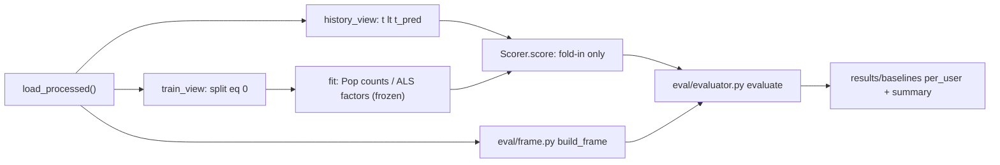

# M3 设计：Shared Full-catalog Evaluator + Popularity / implicit ALS（Revision 1）

本轮只做设计，所有内容都在 P1（[PLAN.md](PLAN.md) §3b）框架内。Q1-Q5 已按 Review 批准（§7）；§8 列出仍需确认的事项。

## 0. 实测事实（只读核查）

- **两类低信号 Item**：
  - Test Positive 落在 Train-unseen Video 上：long_view 4、like 0。
  - 落在 Train 见过、但该 Action 没有 Train Positive 的 Video 上：long_view 194、like 324（约占 like 的 9%）。
- **Test 中 ALS 的无信号用户**（粗略 Population；T 之前没有该 Action 的 Positive）：
  - video/like：1,924 人中 598 人。加入 long_view 辅助信号后只剩 34 人。
  - video/long_view：465 人。
  - 只看 Train（no-fold-in 口径）：long_view 1,146 人，like 703 人。
- **implicit 0.7.3**：本地只有 CPU 版。`fit()` 用随机初始化加 CG；每轮先解 user 再解 item，所以 fit 结束时的 `user_factors` 是相对上一轮 item factors 解出来的。`recalculate_user()` 是精确 Cholesky。

## 1. 模块划分（架构不变）

- `src/kuairand_rec/eval/views.py`：信息边界只在这里生成。
  - `train_view(events)`：返回 `split==0` 的事件，并调用 `assert_train_only`。
  - `history_view(events, split_name, meta)`：返回 `time_ms < t_pred` 的事件，并断言边界：
    - val 时 `split.max() == 0`。
    - test 时 `split.max() <= 1`。
    - 不允许 `t_pred > T_test`。
- `src/kuairand_rec/eval/frame.py`
  - `build_frame(events, label_conflicts, cat, split, target, action, masked) -> EvalFrame`
  - `EvalFrame` 字段：`users`（有序）、`gt` CSR、`mask` CSR（no-mask 时为空）、`hist_len_full/capped`、`is_train_oov_user`、`counts`、`frame_id`、`population_id`。
  - Cold users 另建一个 `kind="cold"` frame，仅供 Pop 使用。
- `src/kuairand_rec/eval/metrics.py`
  - `rank_topk(scores, mask_csr, k_max) -> (rows, valid)`
  - `per_user_metrics(rows, valid, gt_csr, ks)`
- `src/kuairand_rec/eval/evaluator.py`
  - `Scorer` Protocol 只有 `score(users, ctx) -> float32[n, n_items]`，没有 `fit`。`-inf` 表示 unscorable。
  - `EvalContext(split, t_pred, history)`：`history` 只能来自 `history_view`。
  - `evaluate(scorer, frame, ks=(10,20,50))`
  - `write_results(...)`
- `src/kuairand_rec/baselines/popularity.py`：`PopularityScorer.from_train(train_view, cat, action)`。
- `src/kuairand_rec/baselines/als.py`：`build_confidence`、`fit_als`、`fold_in`、`ALSScorer`，见 §4。
- `src/kuairand_rec/baselines/run.py`，以及 `configs/eval.yaml`、`configs/baselines.yaml`。
- 复用的 M2 资产：`load_processed()`、`prediction_time()`、`HistoryIndex.seen_rows()`（未截断）、`history_length()`、`Catalogs`、`popularity_*.parquet`（用作交叉校验）、`label_conflict_events.parquet`、`assert_train_only()`。

## 1b. 信息边界（Revision 新增，接口强制执行）

- **Fit**：只发生在 runner 中，模型构造前调用一次，输入只能是 `train_view(events)`。
  - Pop counts 与 ALS item factors（以及 train user factors）fit 完后冻结：
    - `ALSModel` 是 frozen dataclass，数组设为 `setflags(write=False)`。
    - 记录 `train_fingerprint`（train 事件 key 的 hash）。
- **Score**：Scorer 只能拿到 `ctx.history`，并且只用它构造 fold-in 的 `C_u`。
  - 没有任何代码路径会用 `history` 更新 Y 或 counts。
  - Val 的 history 只有 train；Test 的 history 是 train+val。
- **GT**：只存在于 `EvalFrame` 中。Scorer 只收到 `frame.users`（user id 数组），拿不到 GT。Mask 统一由 Evaluator 施加。

## 2. Evaluator 核心流程

对每个 (split, target, action)：

1. 取 Positive 事件，映射到 catalog row。Music 中 `music_id=0` 计入 sentinel，其他映射不到的计入 OOC。
2. 按 (user, item) 去重得到 raw GT。共享同一 Music 的多个 Video 塌缩为一个 Music。
3. **Label-conflict**：被删事件的 `{a}_any=1` 只表示"至少有一行 raw row 是正标签"，并不代表它确实是 GT。
   - 这些事件永远不进入 GT、Mask 或 History。
   - 报告为 `label_conflict_possible_gt_pairs`（上界，只计不在其他 raw GT 中的 pair），同时报告事件数。
4. **Seen Mask**：调用 `seen_rows(users, T, target)`（未截断，严格 t < T），被 Mask 的 GT 从分母中移除并计数，排序时也移除这些候选。
5. 计数顺序固定：label-conflict → OOC → sentinel → mask。
6. **Population**：`|GT_eff| ≥ 1` 且 `hist_len_full ≥ 1`。另外计数 cold、all-masked、OOV-user、GT 落在 Train-unseen 上的情况。
7. **排序**：
   - 先校验 scores：float32、shape 正确、无 NaN/+inf。
   - Masked 位置置为 `-inf`，再用 stable argsort 实现 Score 降序、Index 升序。
   - `valid = score > -inf`：`-inf` 的位置永远不算 Hit。
8. **Metrics**：
   - `Recall@K = hits/|GT|`
   - `NDCG@K` 用二值 gain，IDCG 取 `min(|GT|,K)` 个相关项。
   - 用户级 Macro 平均。0 Hit 和 no-signal 用户都留在分母里。
9. **Sanity**：值在 [0,1]；Recall 随 K 不降；行数等于 n_users；`frame_id` 与 Frame 一致。
10. **No-mask（Q4）**：
    - Population 与 masked frame 完全相同，因此 `population_id` 相同。
    - GT 不去除 seen 项，排序不施加 Mask。
    - `frame_id` 独立计算。
11. **frame_id / population_id**（Revision 2）：
    - 用 sha256 计算，输入为规范化字节（int64 little-endian 数组，以及 sort_keys 的 JSON 标量）。
    - `population_id`：schema version、split、target、action、t_pred、**完整有序的 catalog item ids**、**有序的 evaluated user ids**。
    - `frame_id`：`population_id` + masked 标志 + **GT CSR 实际内容（indptr+indices）** + **Mask CSR 实际内容**。
    - 同一任务内，所有模型必须有相同的 `frame_id`。Mask 与 No-mask 之间按 `user_id` 配对，并断言 `population_id` 相同。

### 已识别的 Silent Metric Bug（对策不变，摘要）

- argpartition 在 K 边界的 tie 不确定：改为全量 stable sort。
- `-inf` 位置被填进 Top-K：用 `valid` 掩掉。
- 零向量用户退化成按 Index 排序会产生虚假 Hit（前 50 行的 Hit 份额是均匀值的约 1.8 倍）：用 Q2 strict 处理。
- 分母或 IDCG 定义错误：手算测试覆盖。
- Mask 取自截断后的 History：只调用 `seen_rows`。
- 用户或 catalog 行对齐错位：置换测试加 shape 断言。
- 分数精度不足导致大量 tie：强制 float32。

## 3. Popularity

- 用 `train_view` 重新计算 counts，并与 M2 的 `popularity_*.parquet` 逐行对比（交叉校验）。Music 分数等于其所有 Video 之和。
- Train-unseen 和零 Positive 的 Item 得 0 分，按 Index 排在最后（P1-6b）。Val 和 Test 都使用 Train counts。
- Cold-user 单独表只出 Pop。

## 4. implicit ALS

**变体（Q1）**：每个 (target, action) 独立 fit。

- `als`：long_view 任务，信号只用 long_view。
- `als_like_pure`：like 任务，`aux_w=0`。
- `als_like_aux`：like 任务，`aux_w>0`，在 Val 上从非零值中选（初始 grid 只有 0.3）。
- 四个任务都分别报告 fold-in 主行和 no-fold-in reference 行。

**Confidence**：`build_confidence(events, cat, target, action, aux_w, alpha)` 是**唯一**的信号定义，fit 和 fold-in 都调用它。

- 按 pair 计算：`r_ui = 1[action any] + aux_w · 1[long_view any]`，long_view 任务中 `aux_w ≡ 0`。
- `p_ui = 1[r_ui > 0]`，`C_ui = 1 + α · r_ui`。
- Music：对 (u, music_row) 取"该用户在共享这个 Music 的任意 Video 上的信号"；`music_id=0` 不计入。

**Fit（只用 train）**：

- 输入为 `train_view`，构造训练矩阵。
- 只把有 ≥1 个非零项的用户行和 Item 列放进 `implicit.fit`。这与包含全零行列的精确解等价，同时避免 CG 残留的随机初始化进入 YᵀY。
- **Scorable（Q3）**：Item 列在**当前配置的** train 矩阵中有非零信号即为 scorable。例如在 aux 变体中，有 long_view 正例的 Item 也是 scorable。
- 其余 Item 一律为 `-inf`。Unscorable 的 GT 仍保留在分母中，并按每个模型、每个任务单独计数（`n_gt_unscorable`）。

**用户向量**：

- **Fold-in 主行**：
  - 自写闭式解 `x_u = (YᵀY + Yᵀ(C_u−I)Y + λI)^{-1} Yᵀ C_u p_u`，只使用 scorable 列，Y 冻结。
  - Val 用 `history_view(val)`（只含 train），Test 用 `history_view(test)`（train+val）。
  - History 中落在 unscorable Item 上的交互没有因子，会被丢弃并计数。
- **No-fold-in reference**（Revision 1）：
  - 直接使用 `fit` 得到的 train user factors，不做任何重新计算。只在 Test 上评估，与主行用同一个 fitted model，不另外选超参。
  - 记录说明：implicit 每轮先解 user 再解 item，所以这组因子比最终 Y 早半个 iteration。这是已知性质，只记录，不修正。
- **Train-history 重新 fold-in**：不放进报告。它在程序上与 Val 主行相同，只作为测试中的 diagnostic，命名为 `als_refold_train`，不与 no-fold-in 混用。

**No-signal（Q2 strict）**：以下用户的全部分数为 `-inf`，指标记 0，仍留在 Population 中，并报告 `n_no_signal`：

- Fold-in 行：没有 scorable 交互。
- No-fold-in 行：train-OOV 用户，或 train 矩阵中没有非零行。

任何路径都不得使用零向量或未训练的随机向量。

**调参（Q5，初始小 grid）**：

- 所有任务使用同一个基础 grid：factors {64,128} × reg {0.01,0.1} × α {10,40}，共 8 组；iterations 固定 20，seed 0。
- like 的 Pure 变体（aux_w=0）和 Aux 变体（aux_w=0.3）各自用这 8 组，预算相同。
- 选择指标为 Val masked Recall@20，NDCG@20 作 tie-break。
- 不用 Test 调参，也不在 Train+Val 上重新 fit。
- 扩大 grid 和多 seed 列为可选 todo。三塔的 Early Stopping 细节留到 D1。

**确定性**：设置 `random_state=seed`，固定 `num_threads`。用测试验证两次 fit 结果逐位相等，否则改为单线程。

## 5. 输出格式（兼容 M5）

- `results/baselines/frames/{split}_{target}_{action}[_nomask|_cold].parquet` 加 `frames_summary.json`：包含所有计数、`frame_id` 和 `population_id`。
- `results/baselines/per_user/{model}/{split}_{task}[_nomask].parquet`，列为：
  - `user_id`
  - `hits/recall/ndcg@K`
  - `has_signal`、`n_gt_unscorable`
  - `frame_id`、`population_id`
- 汇总文件：
  - `metrics.csv`：长表，含 `n_no_signal`。
  - `BASELINES.md`：四个任务 × @10/20/50，加上 Users、Excluded、OOC、Sentinel、Masked、Label-conflict-possible、Train-unseen GT、Unscorable GT、No-signal 等计数。
  - `als_tuning.csv`、`run_meta.json`。
- M5 按 `user_id` join，并断言 `frame_id` 相同。M3 不实现 Bootstrap。Parquet 文件已被 gitignore。
- 命令：`uv run python -m kuairand_rec.baselines.run --config configs/baselines.yaml`

## 6. Correctness Tests

测试文件：`tests/test_eval_metrics.py`、`test_eval_frame.py`、`test_baselines.py` 用手造数据；`test_eval_artifacts.py` 用真实数据，数据未构建时 skip。

**保留原有测试**：

- Metrics 手算：
  - GT={2,5}，排序 [5,1,2,…]：NDCG@3 = 0.91972。
  - |GT|=5、K=2 两位都命中：NDCG=1，Recall=0.4。
  - 0 Hit 用户计入平均。
- Ties：按 Index 升序。
- `-inf` 位置不算 Hit。
- GT 去重，包括共享 Music。
- Mask 与分母同步。
- Sentinel / OOC。
- Cold users 与 Empty GT。
- 时间边界：`t == T` 的事件属于 GT、不进入 Mask；`T−1` 的事件进入 Mask；Val Mask 不含 Val 事件。
- 删除或翻转 `t ≥ t_pred` 的事件后，scores 逐位不变。
- Pop 手算。
- 自写 fold-in 与 `recalculate_user` 一致。
- 用户顺序置换后结果不变。
- 真实数据 Oracle。

**Revision 新增或明确的测试**：

- **No-fold-in**：其分数等于 `train_user_factors @ Yᵀ`，并且逐位不同于对 train history 重新 fold-in 的结果（在 iterations 很小的 fixture 上可以检测到差异）。
- **frame_id**：
  - 交换 catalog 中两个 id 的顺序、改变用户顺序、改动一个 GT 或 Mask 元素，都会改变 `frame_id`。
  - Mask 与 No-mask 的 `frame_id` 不同、`population_id` 相同，用户集合也相同。
- **Train-only fit**：
  - `fit_als` 收到 split≠0 的数据时报错。
  - 在 events 中加入或修改 val/test 事件后，`train_view` 得到的 Y 和 train user factors 逐位不变。
  - 用 val/test history 打分前后，Y 的 hash 不变；冻结数组写入时报错。
  - `history_view(val)` 含 split≥1 时报错。
- **Aux like**：
  - 只有 long_view train 正例的 Item：`aux_w=0.3` 时 scorable，`aux_w=0` 时为 `-inf`。
  - 同一个 (u,i) 在 fit 矩阵和 fold-in 的 `C_u` 中值相同（都来自 `build_confidence`）。
- **No-signal**：用户全部 `-inf`，所有 K 的指标都为 0，仍在 per_user 表中，并计入 `n_no_signal`。Train-OOV 用户在 no-fold-in 行中为 no-signal。
- **Label-conflict**：
  - `{a}_any=1` 的事件不进入 GT、Mask、History。
  - 只有在该 pair 没有其他 GT 时才计入 `possible` 计数。
  - 计数名明确为 possible / upper bound。

## 7. 已批准的决策（写入 PLAN.md，作为 M3 决策，不改动 P1）

- **Q1**：采用 B。Pure like ALS（aux_w=0）是独立报告的一行；Aux like ALS 作为额外对照。fit 与 fold-in 共用 `build_confidence`。
- **Q2**：Strict no-signal 处理。
- **Q3**：Scorable 的判定基于当前配置的 train 有效非零信号。Unscorable GT 留在分母中并单独计数。Pop 仍按 P1-6b 给 0 分。
- **Q4**：No-mask 使用固定的主 Population，`frame_id` 独立，`population_id` 共享。
- **Q5**：先用小 grid 调参，扩大 grid 和多 seed 视剩余时间决定。

**与 Assignment / P1 的一致性**：未发现冲突。

- No-fold-in 使用 train user factors：符合 P1-1 "ALS row without fold-in as reference"。
- Q3 是对 P1-6b "unseen items 为 unscorable" 的**收紧性延伸**：P1-6b 本身禁止零向量，而"train 见过但无信号"的 Item 的精确解正是零向量。这条按 M3 决策记录，不修改 P1 原文。
- Strict no-signal 的用户仍满足 P1-1 的 Population 定义（有 History、GT 非空），所以不改变 Population。

## 8. 仍需确认的事项（推荐方案已给出）

- **O1 Like 任务 headline 用哪一个 ALS**
  - 推荐：headline 用 `als_like_pure`，这是 Assignment 要求的 per-action user-video/user-music ALS；`als_like_aux` 作为额外对照行同列展示。
  - Per-user 结果两者都保存，M5 可以对两者都做 paired bootstrap，成本很低。
  - 如果你希望把 aux 作为 headline，需要在 M3 运行前确定。
- **O2 Aux 变体的 aux_w 选择范围**
  - 初始 grid 只有一个非零值 0.3，所以 aux 变体的 aux_w 实际固定为 0.3，Val 上只选 factors/reg/α。
  - 推荐保持这一设定。扩大 grid（例如 {0.1, 0.3, 1}）归入可选 todo。

以上两项都不影响 Evaluator 或 Frame 的实现，可以先开始 metrics/frame/evaluator/Pop 的实现，再确认后跑 ALS。

## 9. 不在 M3 范围

Bootstrap CI、History Bucket 报表、Cold-video H 抽样与实验、随机排序参考线、三塔，属于 M5 和 M4。
