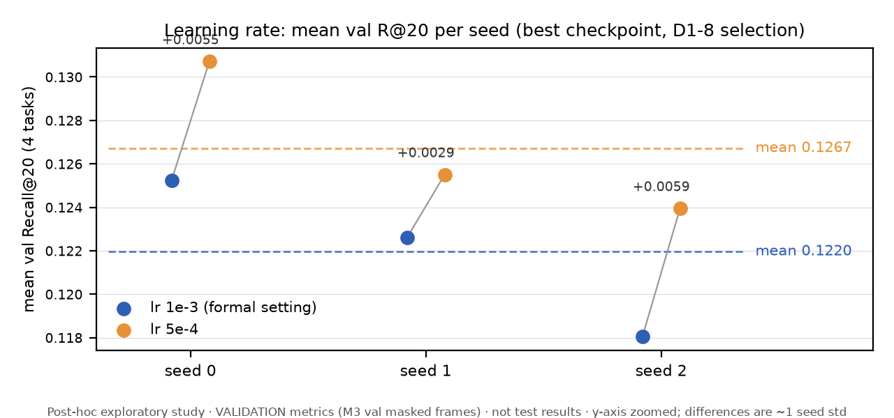
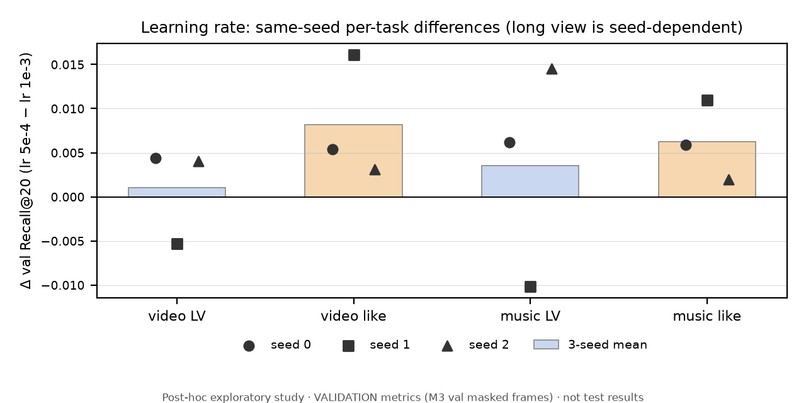
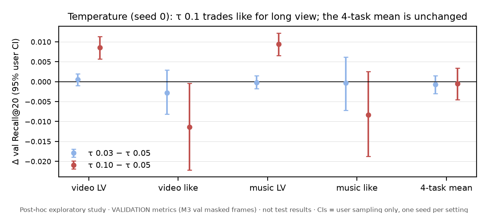
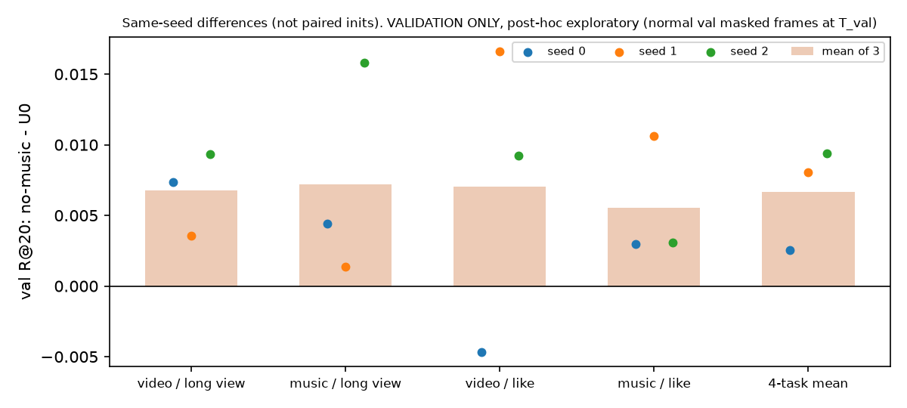

# Post-hoc exploratory results (S9): optimisation and robustness study

**Status:** Waves 1–3 complete (11 runs, jobs 39–49; all exit code 0, parity PASS). Final explore commit `9a1a6b7`. Last updated 2026-10-12 22:40 PT.

**Scope.**
- These are **post-hoc exploratory** experiments. They were designed after the formal v1 test results had been analysed, and they are separate from the formal results. They do **not** replace the formal U0, its test metrics, or any conclusion of [`report/REPORT.md`](../report/REPORT.md).
- **Every number below is a validation metric** on the same validation frames as the M3 baselines (users frozen at T_val, train-only history, seen items masked, frame ids asserted). No explore test number was read or used.
- The integrated discussion is in [`report/REPORT_FULL.md`](../report/REPORT_FULL.md) §2.5 and E6–E8. A short summary is in [`report/REPORT.md`](../report/REPORT.md) §2.4.
- **Terminology.**
  - U0 is the formal three-tower model (user ID + history). LV = long view. Pure ALS = ALS trained on the task's action; Aux ALS = like ALS + 0.3 × the LV signal.
  - All metrics are validation Recall@20 (R@20) or NDCG@20 on the full catalog, with seen items excluded. A difference is A − B on the same users.
  - Brackets `[lo, hi]` give the paired val user-bootstrap 95% CI. `mean ± std` is over training seeds and describes training-seed variability; it is not a CI.
  - "Tie" / "no significant difference" vs a baseline means that CI includes 0. It is **not** a demonstration of equivalence: no equivalence margin was specified or tested.
  - All CIs are nominal, with no multiple-comparison correction.

## 1. Provenance

| item | value |
|---|---|
| Branch / worktree | `explore/s9-opt` (separate worktree, separate server clone and run root; never merged into `main`) |
| Base | `671dde9` (formal M5 training SHA) |
| Wave 1 (jobs 39–43) | explore SHA `1051f86` |
| Wave 2 (jobs 44–46) | explore SHA `a158e5e` |
| Wave 3 (jobs 47–49) | explore SHA `be5ceb9`; analysis at `9a1a6b7` |
| Configs | `configs/explore/*.yaml` on the explore branch, each one setting away from `configs/threetower_u0.yaml` (test-enforced) |
| Analysis scripts | `scripts/explore/analyze_wave1.py`, `analyze_wave2.py`, `diagnose_longview.py`, `analyze_wave3.py`, `plot_wave3.py` on the explore branch (they refuse `metrics.csv` and test per-user files); `analyze_wave3.py`, `plot_wave3.py` and the shared `analyze_wave1.py` are also copied to [`scripts/explore/`](../scripts/explore/) |
| Result copies on `main` | [`results/explore/`](../results/explore/) (byte-identical copies, see `PROVENANCE.md`) |
| Figures | `scripts/make_explore_figures.py` → `report/figures/explore_fig_{a,b,c}_*.png`; `scripts/explore/plot_wave3.py` → `results/explore/wave3/figures/fig{1,2,3}_*.png` |
| Run artifacts | checkpoints, embeddings, logs of all 11 runs: `05_Exploratory_Experiments.zip` (not in git) |

**Selection protocol.** Unchanged D1-8 rule: mean val R@20 over 4 tasks, NDCG@20 tie-break, patience 3, at most 30 epochs.

**Uncertainty.** Two kinds, reported separately:
- a paired val user bootstrap (1,000 resamples), which covers user sampling only;
- training-seed variation (n = 3), which is descriptive.

**Run validity.** All runs pass these checks: exit code 0, strict Direct/Export parity (max |Δ| 0.0), normal condition `133765eb12b75700`, one data fingerprint, `test_used_for_selection = false`, and frame ids equal to M3.

## 2. Experiments

| exp | job | change vs U0 config | role |
|---|---:|---|---|
| `x_u0_s1`, `x_u0_s2` | 39, 40 | `train.seed: 1 / 2` | seed calibration |
| `x_lr5e4` | 41 | `train.lr: 5e-4` | learning rate |
| `x_tau003`, `x_tau010` | 42, 43 | `train.tau: 0.03 / 0.1` | temperature |
| `x_u0_repro` | 44 | none (same config at the explore SHA) | reproduction control for formal job 27 |
| `x_lr5e4_s1`, `x_lr5e4_s2` | 45, 46 | lr 5e-4 at seeds 1 / 2 | learning-rate replication |
| `x_nomusic_repro`, `_s1`, `_s2` | 47–49 | formal no-music ablation (`use_music: false`) at seeds 0/1/2 | no-music replication (Wave 3) |

## 3. Reproduction controls

`x_u0_repro` (job 44) reproduces formal job 27 **bitwise** (`results/explore/wave2/repro_vs_job27.json`):
- all 68 train-log records;
- all 10 validation epochs and best epoch 6;
- the `best.pt` state dict, compared tensor by tensor;
- the 8 val-user and item embedding files;
- every val per-user metric.

Only the checkpoint *file* hash differs, because of pickled metadata.

`x_nomusic_repro` (job 47) reproduces the formal no-music ablation, job 35, bitwise in the same way (`results/explore/wave3/repro_job47_vs_job35.json`).

## 4. Seeds × learning rate

Best checkpoint per run. Validation R@20 / NDCG@20.

| lr | seed (job) | best ep | video LV | video like | music LV | music like | mean R@20 | mean N@20 |
|---|---|---:|---|---|---|---|---:|---:|
| 1e-3 | 0 (44 = 27) | 6 | 0.1260 / 0.0781 | 0.1223 / 0.0589 | 0.1308 / 0.0803 | 0.1218 / 0.0599 | 0.1252 | 0.0693 |
| 1e-3 | 1 (39) | 7 | 0.1267 / 0.0770 | 0.1089 / 0.0515 | 0.1344 / 0.0805 | 0.1204 / 0.0586 | 0.1226 | 0.0669 |
| 1e-3 | 2 (40) | 5 | 0.1241 / 0.0747 | 0.1129 / 0.0564 | 0.1203 / 0.0728 | 0.1149 / 0.0575 | 0.1180 | 0.0653 |
| 5e-4 | 0 (41) | 6 | 0.1304 / 0.0803 | 0.1277 / 0.0635 | 0.1370 / 0.0831 | 0.1277 / 0.0629 | 0.1307 | 0.0724 |
| 5e-4 | 1 (45) | 4 | 0.1214 / 0.0727 | 0.1250 / 0.0624 | 0.1242 / 0.0747 | 0.1314 / 0.0631 | 0.1255 | 0.0682 |
| 5e-4 | 2 (46) | 9 | 0.1281 / 0.0771 | 0.1160 / 0.0536 | 0.1349 / 0.0793 | 0.1168 / 0.0537 | 0.1239 | 0.0659 |

Across seeds (n = 3), mean ± std (min–max):

| | lr 1e-3 | lr 5e-4 |
|---|---|---|
| mean val R@20 | 0.1220 ± 0.0036 (0.1180–0.1252) | 0.1267 ± 0.0035 (0.1239–0.1307) |
| mean val NDCG@20 | 0.0672 ± 0.0020 (0.0653–0.0693) | 0.0689 ± 0.0033 (0.0659–0.0724) |

Same-seed differences (lr 5e-4 − lr 1e-3), val R@20, with the paired user-bootstrap CI:

| seed | mean R@20 | video LV | video like | music LV | music like |
|---:|---|---|---|---|---|
| 0 | +0.0055 [+0.0026, +0.0085] | +0.0044 [+0.0023, +0.0064] | +0.0054 [−0.0018, +0.0131] | +0.0062 [+0.0042, +0.0084] | +0.0059 [−0.0020, +0.0143] |
| 1 | +0.0029 [−0.0014, +0.0073] | −0.0053 [−0.0081, −0.0027] | +0.0161 [+0.0044, +0.0283] | −0.0101 [−0.0131, −0.0070] | +0.0110 [−0.0000, +0.0229] |
| 2 | +0.0059 [+0.0023, +0.0099] | +0.0040 [+0.0011, +0.0071] | +0.0031 [−0.0064, +0.0131] | +0.0145 [+0.0114, +0.0179] | +0.0020 [−0.0090, +0.0125] |
| mean | +0.0048 | +0.0010 | +0.0082 | +0.0035 | +0.0063 |

**Findings.**
- **Seed variation is large.** Training-seed variation of the 4-task mean (std 0.0036, range 0.0072) exceeds the user-bootstrap SE (about 0.0015–0.002). Single-seed differences below about 0.007 are not interpretable.
- **lr 5e-4 helps, but only modestly.** It is numerically higher on 3/3 seeds (+0.0048 on average), but that is about one seed std, the groups overlap, and the gain comes mostly from the like tasks.
- **Long view is seed-dependent.** It is down clearly on seed 1, which stopped at epoch 4.
- **Status:** suggestive; not a demonstrated improvement.

## 5. Temperature (seed 0 only)

Val R@20 difference vs τ = 0.05 (formal U0 seed 0), with the paired user CI:

| | video LV | video like | music LV | music like | 4-task mean |
|---|---|---|---|---|---|
| τ 0.03 | +0.0005 [−0.0010, +0.0020] | −0.0028 [−0.0081, +0.0029] | −0.0002 [−0.0017, +0.0015] | −0.0003 [−0.0071, +0.0062] | −0.0007 [−0.0030, +0.0015] |
| τ 0.10 | +0.0085 [+0.0057, +0.0114] | −0.0114 [−0.0222, −0.0004] | +0.0094 [+0.0065, +0.0122] | −0.0083 [−0.0188, +0.0026] | −0.0005 [−0.0045, +0.0034] |

τ = 0.1 trades like for long view; neither temperature improves the 4-task mean.

## 6. Validation comparison with the M3 baselines

These use the same val frames, catalog and seen mask as the runs above. Baseline val R@20 values:

| | video LV | video like | music LV | music like |
|---|---:|---:|---:|---:|
| Pop | 0.0848 | 0.0889 | 0.0891 | 0.0904 |
| Pure ALS | 0.1339 | 0.0620 | 0.1361 | 0.0634 |
| Aux ALS | – | 0.1077 | – | 0.1166 |

**Long view: model − Pure ALS (val R@20, paired CI).** \* marks a CI that excludes 0 (CI omitted for brevity); s0/s1/s2 = seeds 0/1/2. The absolute Pure ALS values are in the table above.

| run | video LV | music LV |
|---|---|---|
| U0 lr 1e-3, s0 / s1 / s2 | −0.0079\* / −0.0072\* / −0.0099\* | −0.0053\* / −0.0017 [−0.0061, +0.0024] / −0.0158\* |
| lr 5e-4, s0 / s1 / s2 | −0.0035 [−0.0076, +0.0005] / −0.0125\* / −0.0058\* | +0.0009 [−0.0035, +0.0052] / −0.0118\* / −0.0012 [−0.0053, +0.0028] |
| τ 0.03, s0 | −0.0074\* | −0.0055\* |
| τ 0.10, s0 | +0.0006 [−0.0035, +0.0048] | +0.0041 [−0.0001, +0.0081] |
| formal no-music, s0 | −0.0005 [−0.0045, +0.0033] | −0.0008 [−0.0049, +0.0032] |
| formal no-history, s0 | −0.0263\* | −0.0230\* |

| no-music, s0 / s1 / s2 (Wave 3) | −0.0005 / −0.0036 / −0.0005 (all CIs include 0) | −0.0008 / −0.0003 / +0.0001 (all CIs include 0) |

**Long view.** The best runs show no significant R@20 difference from Pure ALS (CI includes 0), and some are numerically slightly above it. None has a CI-supported advantage.

**Like.** Every run is above Pure ALS (+0.053 to +0.068, CIs exclude 0). Against Aux ALS:
- video like: lr 5e-4 seeds 0 and 1 are above (+0.0200, +0.0173, CIs exclude 0), and seed 2 ties;
- music like: all three tie.

These are validation statements and are not comparable with the formal test tables.

## 7. Selection vs per-task optimum

`results/explore/wave3_review/selection_vs_task_best.csv`:
- In 9 of 10 runs, the long-view tasks peak 2–3 epochs after the epoch chosen by the 4-task mean, leaving 0–0.011 val R@20 per task.
- Likes peak at epochs 3–7.
- τ = 0.1 is the exception: it selects epoch 8, where long view peaks.

## 8. No-music review (read-only diagnostics)

Sources: `nomusic_vs_u0_epochwise.json`, `init_fusion_scale.json`, `WAVE3_GATE_REVIEW.md`.

**What was observed.**
- On video LV, the formal no-music run is above every U0 seed at every epoch, and above the 3-seed per-epoch maximum at 9/9 epochs. On music LV it is above at 9/10, 9/10 and 9/9 epochs.
- At initialisation, the music-tower output entering the video tower has norm 11.3, against 0.16 for the ID embeddings. It carries about 20% of the first-layer pre-activation variance.

**Candidate explanations (not yet distinguished).**
- (i) ID competition;
- (ii) gradient interference through the shared music tower;
- (iii) the input-scale imbalance;
- (iv) seed luck.

**Decisions.**
- **Gated fusion:** rejected. It is a pure re-parameterisation, so its effect could not be interpreted.
- **Stop-gradient fusion:** deferred; not run.
- **No-music seed replication:** done (Wave 3, §9).

## 9. Wave 3: no-music ablation at three seeds

Sources:
- [`results/explore/wave3/wave3_analysis.md`](../results/explore/wave3/wave3_analysis.md);
- `validation_comparison.csv`, `paired_nomusic_minus_u0.csv`, `validation_bootstrap.csv`,
  `epochwise_nomusic_minus_u0.csv`, `oracle_epoch_per_task.csv`.

Same seed numbers are **not** paired initialisations, because the first-layer width differs.

| arch | seed (job) | best ep | video LV | video like | music LV | music like | mean R@20 | mean N@20 |
|---|---|---:|---|---|---|---|---:|---:|
| U0 | 0 (44 = 27) | 6 | 0.1260 / 0.0781 | 0.1223 / 0.0589 | 0.1308 / 0.0803 | 0.1218 / 0.0599 | 0.1252 | 0.0693 |
| U0 | 1 (39) | 7 | 0.1267 / 0.0770 | 0.1089 / 0.0515 | 0.1344 / 0.0805 | 0.1204 / 0.0586 | 0.1226 | 0.0669 |
| U0 | 2 (40) | 5 | 0.1241 / 0.0747 | 0.1129 / 0.0564 | 0.1203 / 0.0728 | 0.1149 / 0.0575 | 0.1180 | 0.0653 |
| no-music | 0 (47 = 35) | 6 | 0.1334 / 0.0802 | 0.1177 / 0.0558 | 0.1352 / 0.0812 | 0.1248 / 0.0595 | 0.1278 | 0.0692 |
| no-music | 1 (48) | 4 | 0.1303 / 0.0792 | 0.1254 / 0.0608 | 0.1358 / 0.0807 | 0.1311 / 0.0629 | 0.1306 | 0.0709 |
| no-music | 2 (49) | 5 | 0.1334 / 0.0801 | 0.1221 / 0.0569 | 0.1362 / 0.0810 | 0.1179 / 0.0583 | 0.1274 | 0.0691 |

Cells are val R@20 / NDCG@20.

Across seeds (n = 3), mean ± std:

| arch | mean val R@20 | video LV | music LV |
|---|---|---|---|
| U0 | 0.1220 ± 0.0036 | 0.1256 ± 0.0014 | 0.1285 ± 0.0073 |
| no-music | 0.1286 ± 0.0018 | 0.1324 ± 0.0018 | 0.1357 ± 0.0005 |

Same-seed differences (no-music − U0), val R@20:

| seed | 4-task mean | video LV | music LV | video like | music like |
|---:|---:|---|---|---|---|
| 0 | +0.0025 | +0.0073 [+0.0050, +0.0097] | +0.0045 [+0.0022, +0.0070] | −0.0047 [−0.0131, +0.0050] | +0.0030 [−0.0065, +0.0118] |
| 1 | +0.0080 | +0.0036 [+0.0009, +0.0062] | +0.0014 [−0.0013, +0.0039] | +0.0166 [+0.0070, +0.0273] | +0.0106 [+0.0004, +0.0226] |
| 2 | +0.0094 | +0.0094 [+0.0069, +0.0119] | +0.0158 [+0.0133, +0.0187] | +0.0093 [−0.0008, +0.0197] | +0.0031 [−0.0060, +0.0128] |
| mean | **+0.0066** | **+0.0068** | **+0.0072** | +0.0071 | +0.0056 |

**Findings.** All are validation-only and descriptive, with n = 3 per arm.
- **Both long-view tasks improve on 3/3 seeds**, and so does the 4-task mean.
  - The no-music ranges lie above the U0 ranges: video LV 0.1303–0.1334 vs 0.1241–0.1267; 4-task mean 0.1274–0.1306 vs 0.1180–0.1252.
  - On common epochs, no-music is above U0 on video LV at 10/10, 8/8 and 9/9 epochs, and on music LV at 9/10, 8/8 and 9/9.
  - At each task's own best epoch, the lowest no-music seed is still above the highest U0 seed on both LV tasks.
  - So the effect is not an artefact of 4-task early stopping.
- **Like is not systematically harmed.** 5 of 6 seed-task differences are positive. The one negative difference (video like, seed 0) has a CI that includes 0.
- **Long view vs Pure ALS.**
  - R@20: all 6 no-music CIs include 0, i.e. no significant difference. This is **not** a demonstration of equivalence. U0 is below ALS on video LV for 3/3 seeds.
  - NDCG@20 (secondary metric): no-music is above Pure ALS on 6/6 seed-task pairs (+0.0030 to +0.0043). The nominal 95% CIs exclude 0, uncorrected for multiple comparisons and not confirmed on test.
- **Reproduction.** Job 47 = job 35 bitwise.
- **Mechanism: not identified.** Removing the input also removes the video-loss gradient into the shared music tower, so (i)–(iii) of §8 are not separated. A stop-gradient control is future work.
