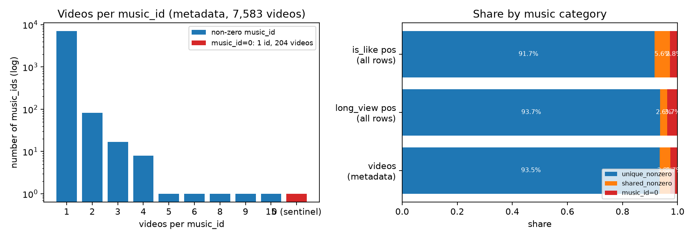
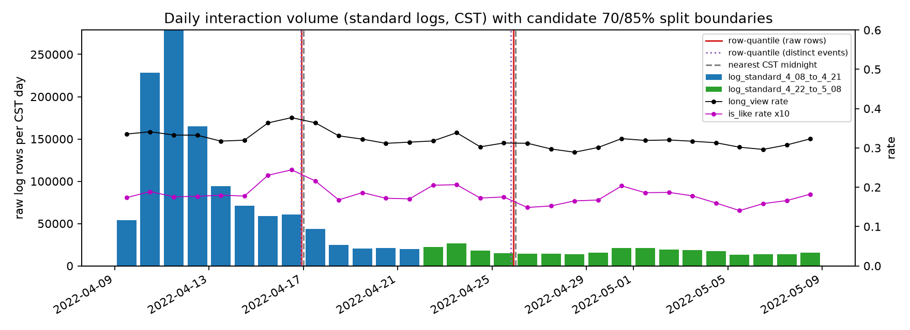
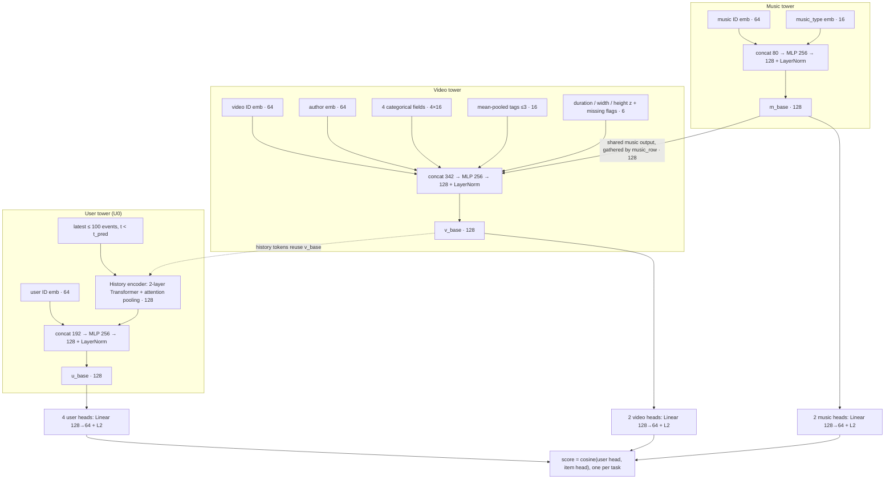
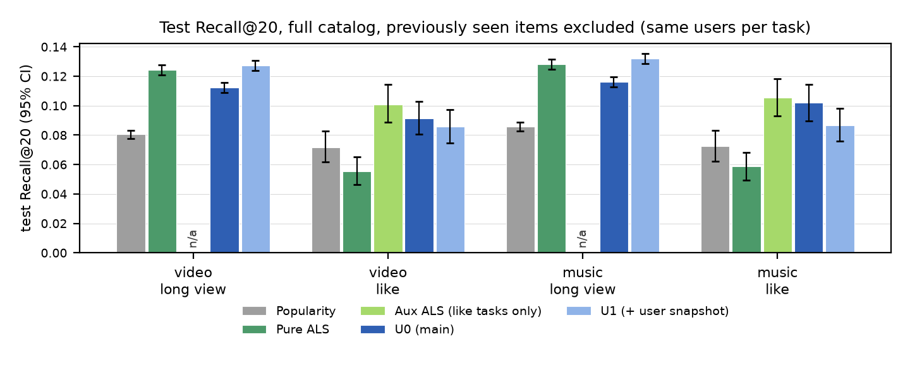
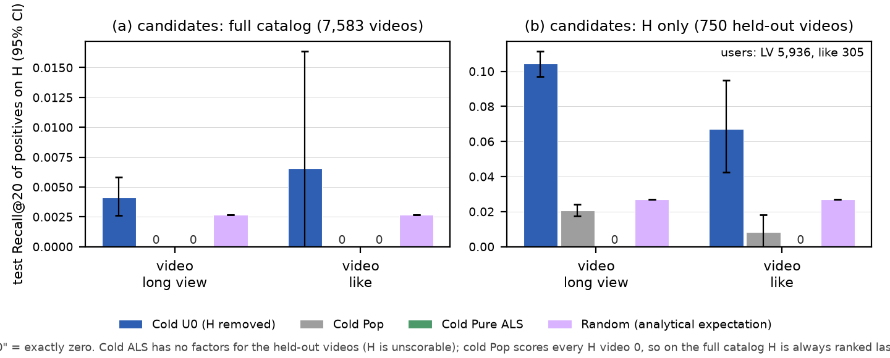
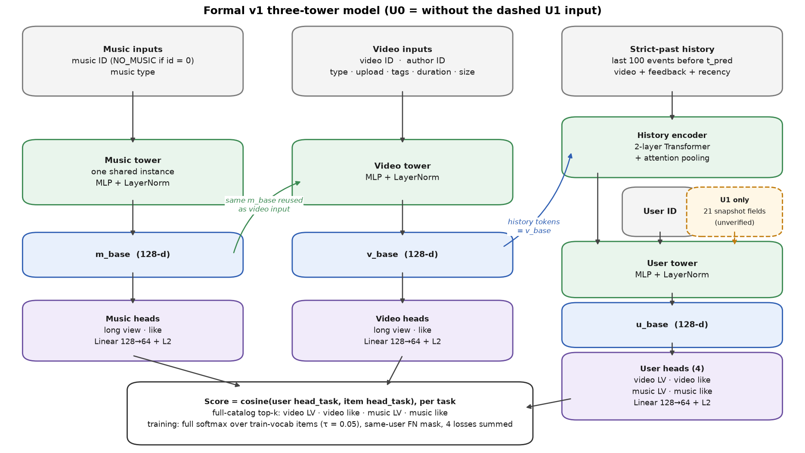

# Leakage-Controlled Multi-Action Three-Tower Retrieval on KuaiRand-Pure

**Project Walkthrough**

> One sentence: a leakage-controlled, fairly evaluated three-tower retriever that beats Popularity on every task, does **not** beat ALS on long view, and whose failure modes I diagnosed and turned into concrete next steps.

Sources for every number: [`report/REPORT.md`](../report/REPORT.md), [`report/REPORT_FULL.md`](../report/REPORT_FULL.md), [`report/tables/`](../report/tables/), [`results/`](../results/).

---

## 1. The Task and What I Delivered

**Task.** From the *full catalog*, retrieve **videos** and their **background-music IDs** for two actions → four retrieval tasks:

| | long view (**LV**) | like |
|---|---|---|
| **video** (7,583 items) | video / LV | video / like |
| **music** (7,201 items) | music / LV | music / like |

**Delivered.** Audit → leakage-controlled pipeline → shared evaluator → Popularity + implicit ALS → three-tower model → cold-video experiment + 2 ablations → `retrieve()` with export/direct parity → report.

**Model names used throughout**
- **U0** — main three-tower model: user ID + strict-past history, **no user metadata**.
- **U1** — U0 + 21 user-snapshot fields whose availability at prediction time cannot be verified (leakage caveat).

**Headline (formal test):** U0 > Popularity on all 4 tasks · U0 < Pure ALS on LV · on like, U0 is not significantly different from Aux ALS.

---

## 2. What the Audit Found

*Observe first, filter nothing* — `results/audit/AUDIT.md` (30/30 consistency checks).

| Finding | Number | Consequence |
|---|---|---|
| Scale | 1,436,609 rows · 27,077 users · 7,583-video catalog | — |
| Action sparsity | LV 33.2% of rows · like **1.85%** | like needs task-level balancing |
| Music ≈ video | 7,201 non-zero music IDs, only **112** shared (max 15 videos) | music adds little beyond video (later: E5) |
| `music_id = 0` | 204 videos | treated as a "no music" sentinel (assumption) |
| Duplicates | 21,987 exact copies, ~99% in tabs 5/6 | collapse; keep whole rows |
| Same-millisecond events | 10% of rows | strict `t < t_pred` |
| Leakage sources | monthly statistics file · undated user snapshot | refuse file · split U0 / U1 |



*Source: `results/audit/figures/music_videos_per_id.png`*

---

## 3. Leakage-Controlled Data Pipeline

**Cleaning** (key = user, video, time): collapse exact duplicates · conflict groups keep one *whole* row · 2 label conflicts dropped and counted · **no k-core filtering**.

**Global chronological split** at CST midnights (no timestamp spans two splits):

| split | dates (2022) | events | share |
|---|---|---:|---:|
| train | 04-09 – 04-16 | 997,078 | 70.6% |
| val | 04-17 – 04-25 | 208,393 | 14.7% |
| test | 04-26 – 05-08 | 207,663 | 14.7% |

**Leakage controls**
- History = latest ≤ 100 events with **t < t_pred** (same-timestamp siblings excluded); feedback younger than 20 min hidden (assumption).
- Statistics file refused by the loader; vocabularies, scalers, Popularity, ALS factors fitted on **train only** (assertion-guarded).
- Val only selects the ALS grid point and the three-tower epoch; test evaluated once (`test_used_for_selection = false`).
- User snapshot is bounded at ≤ 2022-05-02 (inside test) → **U0** uses no user metadata; **U1** reported with caveat.



*Source: `results/audit/figures/daily_volume_splits.png`*

---

## 4. Evaluation Protocol

- **Frozen at T_test.** One prediction per user; history = train + val events before T_test.
- **Ground truth (GT)** = de-duplicated set of the user's test positives.
- **Full catalog** ranking (7,583 videos / 7,201 music); train-unseen items stay in catalog and GT → out-of-catalog (OOC) positives = **0**.
- **Seen mask:** items the user interacted with before T_test are removed from candidates *and* GT.
- **Population:** non-empty GT and ≥ 1 history event; users with no history = separate *cold-user* frame.
- **Metrics:** Recall@K (**R@K**) and NDCG@K, K = 10/20/50, users weighted equally, ties by catalog row.
- **CI** = 95% interval from a **paired** user bootstrap (1,000 resamples; every model on the same resampled users). \* = CI excludes 0.
- **Fairness:** every model is scored by one shared evaluator and must match one `frame_id` (hash of users, GT, mask).

| task | evaluated users | GT pairs | seen-excluded | OOC | sentinel-excluded | cold users |
|---|---:|---:|---:|---:|---:|---:|
| video LV | 18,752 | 63,281 | 859 | 0 | – | 437 |
| video like | 1,924 | 3,380 | 63 | 0 | – | 68 |
| music LV | 18,595 | 61,595 | 913 | 0 | 1,670 | 434 |
| music like | 1,895 | 3,307 | 72 | 0 | 67 | 67 |

*Source: `report/REPORT.md` §1.5*

---

## 5. Baselines

| Baseline | Definition |
|---|---|
| **Popularity** | train positive count per item (music = sum over its videos); same list for everyone, seen items masked |
| **Pure ALS** | implicit ALS on the task's own action; item factors from **train only**; user vectors **folded in** from pre-T_test history; 8-point grid selected on **validation** |
| **Aux ALS** | like tasks only: like signal + 0.3 × LV signal — a stronger like baseline that also borrows LV |

**No-signal handling.** A user or item without any signal gets **−∞**, never a random or zero vector. Those users stay in the denominator and are counted.

> Pure ALS cannot score the 608 of 1,924 video-like users who never liked anything before T_test — this matters later.

---

## 6. Three-Tower Architecture — Overview



- **One shared music tower**, run once per step; the video tower consumes its output, so video losses also train it.
- **128-d base** per tower; **separate 64-d head per target × action** (user 4, video 2, music 2).
- U1 adds 21 snapshot fields × 16-d to the user tower. 3.77M parameters.

*Implementation: `src/kuairand_rec/models/towers.py`. Report figure: `report/figures/arch_threetower.png` (Appendix A8).*

---

## 7. Inside Each Tower

| Tower | Inputs (embedding dims) | Encoder | Output |
|---|---|---|---|
| **Music** | music ID (64) · music_type (16) | MLP 80 → 256 → 128 + LN | m_base 128 |
| **Video** | video ID (64) · author (64) · **music-tower output (128)** · video_type, upload_type, upload_dt, music_type (4×16) · mean of ≤ 3 tags (16) · z-scored log duration/width/height + 3 missing flags (6) = **342** | MLP 342 → 256 → 128 + LN | v_base 128 |
| **User (U0)** | user ID (64) · history summary (128) = **192** | MLP 192 → 256 → 128 + LN | u_base 128 |
| **User (U1)** | U0 inputs + 21 snapshot fields (21×16) | same | u_base 128 |

**History token** (one per past event, latest ≤ 100, right-aligned):
`proj(v_base of that video)` + `proj(8 feedback flags + hidden flag)` + `play-ratio bucket emb` + `log-recency bucket emb` + `position emb`
→ 2-layer Transformer (4 heads, PAD masked) → learnable-query **attention pooling** → 128.

**Unseen IDs & robustness**
- PAD / OOV embedding rows are **fixed at zero** (no gradient) → an unseen video is scored from author, music and metadata.
- **ID dropout 0.1** (video, author, music, user) trains that content-only path.
- Feedback of events < 20 min old is zeroed and flagged; recency buckets capped at what training can reach.

---

## 8. Training Objective

**Samples.** Every train event positive for either action (345,365; 18,771 likes), with 4 task masks and its own **rolling strict-past history**.

**Loss** per task — exact full softmax over all train-vocabulary items (7,529 videos / 7,151 music), τ = 0.05:

$$
\ell_r=-\log\frac{\exp(\cos(u_r,i_{y_r})/\tau)}{\sum_{c\notin \mathrm{FN}(r)}\exp(\cos(u_r,i_c)/\tau)},\qquad
L=\sum_{\text{4 tasks}}\overline{\ell}_{\text{task}}
$$

| Requirement | How it is handled |
|---|---|
| Negatives | every other candidate item — exact, no sampling, so **no logQ correction** |
| **Duplicate positives** | candidate columns are unique items → rows with the same label (or videos sharing a music ID) share one column |
| **False negatives** | FN(r) = the user's *other* train positives for that task → set to −∞; the row's own label is never masked; never a model input |
| **Action balance** | equal-weight sum of per-task **means** → each like row ≈ 18× an LV row (~1,006 LV vs ~56 like rows per batch); like also benefits from towers shared with LV |

**Optimisation.** AdamW lr 1e-3, batch 1,024, FP32, deterministic; ≤ 30 epochs, patience 3 on mean val R@20 over 4 tasks; **one seed; v1 not tuned**.

---

## 9. How I Made Sure It's Correct

| Check | What it guarantees |
|---|---|
| Train-only fitting asserted · val-only selection · `test_used_for_selection = false` | no test information in any choice |
| One shared evaluator + `frame_id` per frame | every model sees the same users, GT and mask |
| **Export / direct parity** (separate process, 2,048 users incl. cold / OOV / all buckets) | exported scores and top-50 are **bitwise** equal to direct model scoring |
| `retrieve(user_id, target, action, k)` | served from exported embeddings + ID mappings; reproduces per-user metrics |
| **259 CPU tests** | leakage, masking, metrics, loss, parity, cold-video isolation |
| Independent M3 oracle · `check_report_claims.py` (321 numbers) | baselines and report numbers re-derived independently |

*Sources: `src/kuairand_rec/models/parity.py`, `tests/`, `results/baselines/M3_CORRECTNESS_AUDIT.md`, `scripts/check_report_claims.py`.*

---

## 10. Main Results — Formal Test

**Absolute test R@20 / NDCG@20** (bold = best per column; "–" = Aux ALS is defined for like only)

| model | video LV | video like | music LV | music like |
|---|---|---|---|---|
| Pop | 0.0806 / 0.0457 | 0.0716 / 0.0403 | 0.0856 / 0.0479 | 0.0726 / 0.0412 |
| Pure ALS | **0.1244** / 0.0686 | 0.0555 / 0.0282 | **0.1282** / 0.0705 | 0.0586 / 0.0303 |
| Aux ALS | – | **0.1008 / 0.0469** | – | **0.1054** / 0.0463 |
| **U0 (main)** | 0.1124 / 0.0676 | 0.0913 / 0.0417 | 0.1162 / 0.0691 | 0.1022 / **0.0472** |
| U1 (+ snapshot, leakage caveat) | 0.1274 / 0.0744 | 0.0859 / 0.0397 | 0.1321 / 0.0768 | 0.0864 / 0.0407 |



**Paired R@20 differences** (\* = CI excludes 0)
- U0 − Pop: **+0.020\* to +0.032\*** on all four tasks.
- U0 − Pure ALS: **−0.012\*** on both LV tasks; **+0.036\* / +0.044\*** on like.
- U0 − Aux ALS (like): −0.009 [−0.025, +0.005] / −0.003 [−0.019, +0.014] — **not significant (not equivalence)**.
- U1 reaches Pure-ALS level on LV (+0.003 / +0.004, n.s.) — may partly be leakage. **I do not claim the three-tower model beats ALS.**

*Sources: `report/REPORT.md` Tables 1–2, `report/tables/t1_main_metrics.md`, `t2_paired_diffs.md`, `report/figures/fig1_baselines.png`.*

---

## 11. Where U0 Wins and Loses


**History-length buckets** (events fed to the model at T_test, capped at 100) — U0 − Pure ALS, test R@20:

| task | 1–5 | 6–20 | > 20 (72% of LV users) |
|---|---|---|---|
| video LV | **+0.028\*** | −0.006 | **−0.017\*** |
| music LV | **+0.037\*** | −0.012\* | **−0.016\*** |

- **LV deficit = heavy-user effect.** Largest for histories truncated to 100 (−0.021\* video LV); ALS fold-in uses every interaction.
- **Like gain = coverage.** On the 608 users without a prior like, U0 − Pure ALS = +0.086\*; on users with a prior like, +0.012 (n.s.), and U0 is *below* Aux ALS (−0.022\*).

*Sources: `report/figures/fig3_buckets.png`, `report/tables/t3b_bucket_diffs.md`, `results/final_analysis/ERROR_ANALYSIS.md` (E1, E2).*

---

## 12. Cold-Video Experiment & Ablations — Formal Test

**Controlled cold-video holdout.** H = 750 train-seen videos (10%), drawn from train only, stratified by train popularity. Every H interaction removed from targets, all histories, candidates, FN sets, vocabularies and the cold Pop/ALS fits (12 automated checks). Cold model retrained from scratch.

| candidates | cold U0 | cold Pop | random | cold U0 − random |
|---|---:|---:|---:|---|
| video LV, **H only** | **0.1045** | 0.0207 | 0.0269 | **+0.078\*** |
| video LV, **full catalog** | 0.0041 | 0.0000 | 0.0027 | +0.0014 [−0.0000, +0.0032] (n.s.) |

→ Content features rank new videos well **among themselves**, but on the full catalog cold videos rarely reach the top 20 (not distinguishable from random).



**Ablations** (one config flag each; paired test R@20 difference vs U0)

| | video LV | video like | music LV | music like |
|---|---|---|---|---|
| no history | **−0.012\*** | −0.002 | **−0.011\*** | **−0.017\*** |
| no music input to video tower | **+0.010\*** | +0.007 | **+0.009\*** | −0.008 |

→ History drives LV personalisation. Removing the music input **improves** LV — a negative result for that design choice; reported as is, the specified architecture was kept.


*Sources: `report/REPORT.md` §2.2–2.3, `report/tables/t5_cold_video.md`, `report/figures/fig2_cold_video.png`, `report/figures/fig4_ablations.png`.*

---

## 13. Post-hoc Study — **Validation Only**

> ⚠️ Designed **after** the test results were seen, on a separate branch. **Validation metrics only.** Does **not** replace U0 or change any test number. No-music is **not** the submitted model.

11 single-setting runs; same-config reruns reproduce formal U0 and the formal no-music run **bitwise**.

**Validation R@20** (mean ± std over 3 training seeds; Δ = mean same-seed difference vs U0, seed min–max in braces — a seed range, not a CI)

| setting | video LV | music LV | 4-task mean |
|---|---|---|---|
| U0 (lr 1e-3, τ 0.05) | 0.1256 ± 0.0014 | 0.1285 ± 0.0073 | 0.1220 ± 0.0036 |
| no music input | **0.1324** ± 0.0018 | **0.1357** ± 0.0005 | **0.1286** ± 0.0018 |
| Δ no-music − U0 | +0.0068 {+0.004, +0.009} | +0.0072 {+0.001, +0.016} | +0.0066 {+0.003, +0.009} |
| Δ lr 5e-4 − U0 | +0.0010 {−0.005, +0.004} | +0.0035 {−0.010, +0.015} | +0.0048 {+0.003, +0.006} |
| τ 0.1 (seed 0 only), Δ | +0.0085\* | +0.0094\* | −0.0005 |


- **Seed variation is large:** U0's 4-task mean spans 0.0072 across 3 seeds — as large as most tuning effects.
- **lr 5e-4:** higher on 3/3 seeds by ~1 seed std, mostly on like; LV is seed-dependent. **τ 0.1:** trades like for LV.
- **No-music:** LV higher on 3/3 seeds; like not systematically lower. Its LV R@20 gap to Pure ALS is no longer significant on validation (6/6 CIs include 0) — **not equivalence, not a win**. Mechanism not identified.

*Sources: `report/REPORT.md` Table 4 / §2.4, `docs/EXPLORATORY_RESULTS.md`, `results/explore/wave3/figures/fig2_nomusic_minus_u0.png`.*

---

## 14. Diagnosis → Next Steps

| Failure mode (evidence) | Hypothesis | Next step |
|---|---|---|
| **E2** LV gap concentrated in > 20 histories, worst when truncated | capped, pooled history loses long-range preference; train histories (≤ 7 days) shorter than test (16 days) | per-epoch frozen training histories; longer cap or long-term summary; ensemble with ALS fold-in |
| **E3** cold users: U0 0.039 vs Pop 0.142 R@20 | one shared embedding, under-trained (~1,100 rows/epoch) | learned popularity bias or Pop fallback |
| **E4** cold videos get 0.9% of top-20 slots (9.9% of catalog) | 72% of H have all three IDs OOV; training drops all three with p = 0.001 | whole-item ID dropout; content-only auxiliary loss |
| **E5** music ≈ video (per-user r = 0.88); no-music improves LV | music input acts as a second ID path, or shared-tower gradients interfere | **stop-gradient fusion** to separate the two; re-confirm on a fresh period |
| **E1** like gain is coverage | Aux ALS transfers LV explicitly | LV → like auxiliary target; validation-tuned task weights |

*Source: `report/REPORT.md` §3, §5; `results/final_analysis/ERROR_ANALYSIS.md`.*

---

## 15. Limitations & Lessons Learned

**Limitations**
- Main LV comparison is negative for U0; v1 was not tuned.
- One seed per formal model — test CIs cover user sampling, not training randomness (seed std ≈ 0.004 on validation).
- U1's gain may partly be leakage; U0 uses no user metadata (documented deviation from "ID + usable metadata + history").
- 20-min feedback delay is an assumption; KuaiRand-Pure keeps candidate-pool videos only; random log not used.

**Lessons**
1. **Audit before modelling** — the music finding and the snapshot leak shaped the design.
2. **Fair comparison is engineering** — shared evaluator, frame IDs and parity made every number comparable.
3. **A CI is not a seed study** — single-seed gains of ~0.01 need replication.
4. **Negative results are signal** — the no-music ablation pointed at a concrete, testable fusion question.

---

## 16. Summary

1. A leakage-controlled, fully reproducible four-task retrieval pipeline with a shared, fair evaluator.
2. U0 beats Popularity everywhere; it trails Pure ALS on long view (heavy users) and ties Aux ALS on like (not significant, not equivalence).
3. Each failure mode is diagnosed with evidence and paired with a targeted next experiment.

**Thank you for your listening.**

---

# Appendix — assignment items not covered in detail above

---

## A1. Assignment Coverage Map

| `docs/assignment.md` requirement | Where |
|---|---|
| Dataset audit: entities, actions, music sharing, data quality, filtering | §2, A2 |
| Chronological ~70/15/15 split; strict-past history ≤ 100; no statistics file; train-only popularity | §3 |
| Popularity and implicit ALS for user-video and user-music | §5, §10 |
| User tower: ID + usable metadata + history | §6–7, A6 |
| Music tower; video tower = video ID + music-tower output + author + metadata | §6–7 |
| 128-d base, 64-d projection per target × action, contrastive objective | §6–8 |
| Duplicate positives, false negatives, action balance | §8 |
| Full-catalog R/NDCG@10/20/50, evaluated users, excluded / OOC positives | §4, §10, A3, A4 |
| Bootstrap CIs for the main comparison | §4, §10, A5 |
| History-length breakdown 1–5 / 6–20 / > 20 | §11, A7 |
| Controlled cold-video experiment | §12 |
| At least one controlled ablation | §12 (two) |
| `retrieve(user_id, target, action, k)` + export/direct parity | §9, A8 |
| Reproducible commands, configs, CPU smoke test, focused tests | §9, A9 |
| Report: design, results, error analysis, limitations, next steps | §6–15; `report/REPORT.pdf` |
| Submission artifacts (code, configs, checkpoints, embeddings, results, report, agent logs) | A9 |

---

## A2. Dataset Audit Details

| Item | Value |
|---|---|
| Inputs read | 2 standard logs, `user_features_pure.csv`, `video_features_basic_pure.csv`; random log and statistics file refused |
| Raw rows / users / videos in logs | 1,436,609 / 27,077 / 7,551 (catalog 7,583 from metadata) |
| Authors / non-zero music IDs | 6,510 authors for 7,583 videos · 7,201 music IDs, 112 shared by > 1 video |
| LV / like / click rate | 33.2% / 1.85% / 46.0% · 66.9% of likes are also LV · 6,768 of 27,077 users ever like |
| Official LV rule vs label | 99.76% agreement (duration > 0); mismatches all ≤ 18 s videos within ~1 s → labels kept as is |
| `duration_ms = 0` | 28,874 rows on 237 videos with null metadata duration → treated as missing |
| Cleaning | 21,987 exact duplicates collapsed · 1,486 conflict groups → one whole row · 2 label conflicts dropped · no k-core |
| After cleaning | 1,413,134 events; all users and videos kept |
| Re-consumption | ~1% of test LV positives were seen in train → seen mask costs little GT |

*Sources: `results/audit/AUDIT.md`, `results/data_pipeline/DATA_REPORT.md`.*

---

## A3. Evaluation Counts (test)

| count | video LV | video like | music LV | music like |
|---|---:|---:|---:|---:|
| test positive events | 65,812 | 3,610 | 65,812 | 3,610 |
| sentinel (`music_id = 0`) | 0 | 0 | 1,670 | 67 |
| out-of-catalog | 0 | 0 | 0 | 0 |
| GT pairs removed by seen mask | 859 | 63 | 913 | 72 |
| cold users (no history, separate frame) | 437 | 68 | 434 | 67 |
| **evaluated users** | **18,752** | **1,924** | **18,595** | **1,895** |
| of which train-OOV users | 499 | 65 | 496 | 63 |
| effective GT pairs | 63,281 | 3,380 | 61,595 | 3,307 |

*Source: `results/baselines/BASELINES.md` §2.*

---

## A4. Full Test Metrics (R@10/20/50, N@10/20/50)

**video / long view** (18,752 users)

| model | R@10 | R@20 | R@50 | N@10 | N@20 | N@50 |
|---|---:|---:|---:|---:|---:|---:|
| Pop | 0.0479 | 0.0806 | 0.1388 | 0.0348 | 0.0457 | 0.0621 |
| Pure ALS | 0.0759 | 0.1244 | 0.2282 | 0.0524 | 0.0686 | 0.0969 |
| U0 | 0.0740 | 0.1124 | 0.1950 | 0.0549 | 0.0676 | 0.0902 |
| U1 | 0.0829 | 0.1274 | 0.2184 | 0.0597 | 0.0744 | 0.0994 |

**video / like** (1,924 users)

| model | R@10 | R@20 | R@50 | N@10 | N@20 | N@50 |
|---|---:|---:|---:|---:|---:|---:|
| Pop | 0.0466 | 0.0716 | 0.1304 | 0.0332 | 0.0403 | 0.0532 |
| Pure ALS | 0.0388 | 0.0555 | 0.1004 | 0.0234 | 0.0282 | 0.0387 |
| Aux ALS | 0.0610 | 0.1008 | 0.1795 | 0.0356 | 0.0469 | 0.0648 |
| U0 | 0.0533 | 0.0913 | 0.1757 | 0.0310 | 0.0417 | 0.0606 |
| U1 | 0.0601 | 0.0859 | 0.1616 | 0.0324 | 0.0397 | 0.0570 |

**music / long view** (18,595 users)

| model | R@10 | R@20 | R@50 | N@10 | N@20 | N@50 |
|---|---:|---:|---:|---:|---:|---:|
| Pop | 0.0507 | 0.0856 | 0.1472 | 0.0362 | 0.0479 | 0.0651 |
| Pure ALS | 0.0772 | 0.1282 | 0.2297 | 0.0536 | 0.0705 | 0.0982 |
| U0 | 0.0755 | 0.1162 | 0.2036 | 0.0557 | 0.0691 | 0.0928 |
| U1 | 0.0875 | 0.1321 | 0.2258 | 0.0621 | 0.0768 | 0.1022 |

**music / like** (1,895 users)

| model | R@10 | R@20 | R@50 | N@10 | N@20 | N@50 |
|---|---:|---:|---:|---:|---:|---:|
| Pop | 0.0480 | 0.0726 | 0.1358 | 0.0342 | 0.0412 | 0.0552 |
| Pure ALS | 0.0433 | 0.0586 | 0.0951 | 0.0256 | 0.0303 | 0.0389 |
| Aux ALS | 0.0617 | 0.1054 | 0.2017 | 0.0338 | 0.0463 | 0.0677 |
| U0 | 0.0621 | 0.1022 | 0.1793 | 0.0361 | 0.0472 | 0.0646 |
| U1 | 0.0573 | 0.0864 | 0.1633 | 0.0325 | 0.0407 | 0.0581 |

*Source: `report/tables/t1_main_metrics.md` (also lists the two ablations).*

---

## A5. Bootstrap CIs — Paired Test Differences

| comparison (A − B) | metric | video LV | video like | music LV | music like |
|---|---|---|---|---|---|
| U0 − Pop | R@20 | **+0.0318** [+0.0287, +0.0351] | **+0.0197** [+0.0067, +0.0317] | **+0.0306** [+0.0273, +0.0336] | **+0.0296** [+0.0148, +0.0431] |
| U0 − Pure ALS | R@20 | **−0.0119** [−0.0160, −0.0079] | **+0.0359** [+0.0225, +0.0486] | **−0.0120** [−0.0159, −0.0079] | **+0.0436** [+0.0290, +0.0580] |
| U0 − Pure ALS | N@20 | −0.0010 [−0.0034, +0.0013] | **+0.0135** [+0.0066, +0.0205] | −0.0014 [−0.0039, +0.0011] | **+0.0170** [+0.0095, +0.0241] |
| U0 − Aux ALS | R@20 | n/a | −0.0094 [−0.0252, +0.0051] | n/a | −0.0032 [−0.0190, +0.0137] |
| U1 − Pure ALS | R@20 | +0.0031 [−0.0013, +0.0071] | **+0.0305** [+0.0170, +0.0429] | +0.0039 [−0.0002, +0.0082] | **+0.0279** [+0.0154, +0.0416] |
| U1 − U0 | R@20 | **+0.0150** [+0.0125, +0.0178] | −0.0054 [−0.0156, +0.0049] | **+0.0159** [+0.0132, +0.0186] | **−0.0157** [−0.0272, −0.0044] |

Bold = CI excludes 0. A non-significant difference does not mean equivalence. *Source: `report/tables/t2_paired_diffs.md`.*

---

## A6. User Metadata: Why U0 and U1

- `user_features_pure.csv` is **one undated snapshot**.
- User 25929 has `register_days = 22` but logs from 2022-04-10 → snapshot ≤ **2022-05-02**, inside the test period; no lower bound.
- Of the 21 candidate fields: 2 are time-dependent by definition (`register_days_range`, cumulative `is_video_author`); 19 have unknown historical availability; none can be shown to be available at prediction time.
- Decision: **U0** (main) uses no user metadata; **U1** = U0 + 21 fields (NaN and −124 as own categories; values on < 5 train users → OOV), same config and seed, reported with a leakage caveat.
- U1's LV gain (+0.015\*) may be real signal or leakage; offline data cannot separate the two.

*Sources: `report/REPORT.md` §1.2, `PLAN.md` P1-8.*

---

## A7. History-Length Buckets — Absolute Test R@20

| task | bucket | users | Pop | Pure ALS | Aux ALS | U0 | U1 |
|---|---|---:|---:|---:|---:|---:|---:|
| video LV | 1–5 | 1,162 | 0.1243 | 0.1285 | – | 0.1569 | 0.1919 |
| video LV | 6–20 | 4,053 | 0.0951 | 0.1417 | – | 0.1358 | 0.1531 |
| video LV | > 20 | 13,537 | 0.0725 | 0.1188 | – | 0.1016 | 0.1142 |
| video like | 1–5 | 113 | 0.1389 | 0.0199 | 0.0352 | 0.1382 | 0.1362 |
| video like | 6–20 | 360 | 0.0727 | 0.0512 | 0.1331 | 0.1128 | 0.1081 |
| video like | > 20 | 1,451 | 0.0661 | 0.0593 | 0.0979 | 0.0824 | 0.0765 |
| music LV | 1–5 | 1,141 | 0.1326 | 0.1273 | – | 0.1647 | 0.2055 |
| music LV | 6–20 | 4,011 | 0.1007 | 0.1514 | – | 0.1392 | 0.1633 |
| music LV | > 20 | 13,443 | 0.0771 | 0.1213 | – | 0.1052 | 0.1166 |
| music like | 1–5 | 109 | 0.1442 | 0.0217 | 0.0525 | 0.1434 | 0.1244 |
| music like | 6–20 | 357 | 0.0737 | 0.0705 | 0.1533 | 0.1395 | 0.1099 |
| music like | > 20 | 1,429 | 0.0668 | 0.0584 | 0.0974 | 0.0897 | 0.0777 |

Buckets partition each evaluated population exactly; same users for every model. *Sources: `report/tables/t3_history_buckets.md`, `t3b_bucket_diffs.md`.*

---

## A8. `retrieve()` and Export / Direct Parity

```bash
uv run python -m kuairand_rec.models.retrieve --export_dir artifacts/u0/9218a76_seed0_job27/export \
    --user_id 1 --target video --action long_view --k 10
```

- Reads the T_test user embedding, the full-catalog item embeddings and the ID mappings; cosine → seen mask → stable top-k → raw item IDs.
- Parity runs in a **separate process** reloading config, data, checkpoint and export: 2,048 users (cold, train-OOV, all buckets) × every catalog row × 4 tasks × val/test → max |Δ| = **0.0** (bitwise), 0 top-50 mismatches; `retrieve()` equals the exported scorer; per-user metrics identical.



*Sources: `src/kuairand_rec/models/retrieve.py`, `src/kuairand_rec/models/parity.py`, `artifacts/u0/9218a76_seed0_job27/parity.json`, `report/figures/arch_threetower.png`.*

---

## A9. Engineering, Reproducibility and Artifacts

```bash
uv sync && uv run pytest                                                       # 259 CPU tests (~2 min)
uv run python -m kuairand_rec.data.pipeline --config configs/data.yaml         # data pipeline (~12 s)
uv run python -m kuairand_rec.baselines.run --config configs/baselines.yaml    # Pop + ALS
RUN_ROOT=/tmp/kuairand_runs uv run python -m kuairand_rec.models.train \
    --config configs/threetower_smoke.yaml --max_steps 5                       # CPU smoke (~7 min, end to end)
```

- **Configs:** one YAML per stage — `data`, `baselines`, `threetower_{u0,u1,cold_u0,abl_nohist,abl_nomusic,smoke}`, `cold_video`, `m5_analysis`.
- **Provenance:** U0/U1 trained at `9218a76`; cold and ablations at `671dde9`; each run records git SHA, config, data/condition fingerprints, selection log and per-file sha256. Clean worktree enforced for GPU runs.
- **Artifacts:** code, configs, small results in the repo; checkpoints, exported embeddings, ID mappings, per-user metrics, logs and Cursor agent session logs in the Google Drive bundle (`00_START_HERE.md`, `MANIFEST_SHA256.txt`).
- **Report:** `report/REPORT.pdf` (8 pages); extended `report/REPORT_FULL.md`; every stage re-run locally (`results/final_audit/REPRODUCTION.md`).

*Sources: `README.md` §5–§8, `docs/REPRODUCIBILITY.md`.*
