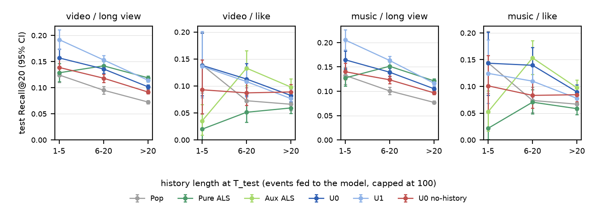
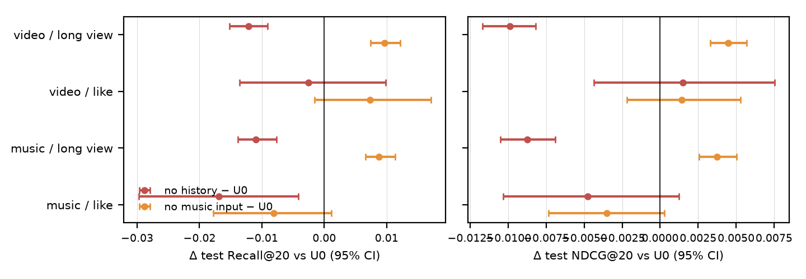

# Abstract

We retrieve both videos and their background-music IDs for two actions, long view (LV) and like, on KuaiRand-Pure. That gives four full-catalog retrieval tasks. Every model is scored by one shared evaluator on identical frozen test frames, with 1,000-resample paired user bootstraps. The models are Popularity, implicit ALS (pure and with an auxiliary LV signal for like) and a three-tower model (user / video / music). We prioritised a leakage-safe protocol:
- a global chronological 70/15/15 split;
- strictly-past histories capped at 100 events;
- train-only fitting of every statistic;
- no monthly statistics file;
- explicit handling of unseen items and users;
- bitwise export/direct score parity.

**Findings (test, Recall@20, 95% paired CI).**
- The main model **U0** (user ID + history) beats Popularity on all four tasks.
- Against pure ALS it is **worse on both LV tasks** (−0.012 each, significant) and **better on both like tasks** (+0.036 / +0.044).
- The like-task gain disappears against ALS with an auxiliary LV signal (CIs include 0).
- **U1** adds a user-metadata snapshot. It reaches ALS level on LV, but it carries an unresolvable snapshot-leakage risk, so U0 is the main model.
- **Controlled cold-video holdout:** among held-out videos only, the content path ranks clearly better than random and the cold baselines. On the full catalog it is **not significantly better than random**.
- **Ablations:** removing history hurts long view. Removing the music input to the video tower **improves** long view, which is a negative result for that design choice.

Supporting material: full tables in `report/tables/`, plotting in `scripts/make_report_tables.py`, error analysis in `results/final_analysis/`, and a requirement-by-requirement audit in `artifacts/final_compliance_review/`.

# 1. Design

## 1.1 Data audit and cleaning

**Inputs.**
- Used: the two standard logs, `user_features_pure.csv` and `video_features_basic_pure.csv`.
- Refused by the loader (`data/io.py` raises on any other file name):
  - the random log (out of scope);
  - `video_features_statistic_pure.csv` (§1.2).

**Raw entities.**
- Logs: 1,436,609 rows, 27,077 users, 7,551 logged videos and 6,489 logged authors.
- Metadata: 7,583 videos, 6,510 authors and 27,285 users.
- Actions:
  - LV is positive on 33.2% of rows and like on 1.85%.
  - Only 6,768 users ever like a video.
  - The official LV rule (play ≥ duration if duration ≤ 18 s, else play ≥ 18 s) reproduces the label on 99.76% of rows with known duration.

**Music sharing.**
- There are 7,201 non-zero music IDs. Music is almost one-to-one with video:
  - 7,089 IDs have exactly one video;
  - only 112 IDs are shared, covering 290 videos, with at most 15 videos per ID;
  - 30 metadata music IDs never occur in the logs.
- `music_id = 0` covers 204 videos. We treat it as a "no music" sentinel; this is a hypothesis, because the dataset dictionary does not define it.
  - Its video interactions are kept for the video tasks.
  - It is never a music candidate and never music ground truth. Its positives are counted as "sentinel excluded" (1,670 LV / 67 like test events).
  - The video tower gives these videos a learnable NO_MUSIC embedding.

**Data quality and cleaning.** Cleaning runs before the split; the event key is (user, video, `time_ms`).
- **Exact duplicates:** 21,987 redundant rows, mostly in tabs 5/6. They are collapsed.
- **Conflict groups:** 1,486, which differ mostly in `hourmin`. Each keeps one *whole* representative row: max `play_time_ms`, then a full-column deterministic tie-break.
- **Label conflicts:** 2 events disagree on the LV label. They are dropped and saved, so the evaluator can report an upper bound of lost ground truth (1 LV test pair).
- **Missing duration:** 28,859 events with `duration_ms = 0` are kept, with duration treated as missing.
- **Not done:** no k-core filtering and no relabelling.
- **Result:** 1,413,134 events, with all 27,077 users and 7,551 videos kept.

An independent pandas recomputation confirms the cleaning:
- cleaned keys = distinct raw keys minus exactly the 2 dropped keys;
- there are no other silent drops;
- the pipeline reruns byte-identically (`results/final_audit/`).

## 1.2 Temporal split and leakage control

**Split.** The split is global and chronological, with cuts at CST midnight: T_val = 2022-04-17 and T_test = 2022-04-26. Events with t < T go to the earlier split. No event lies on a cut, and no timestamp spans two splits.

| split | days (CST) | events | share | LV / like positives |
|---|---|---:|---:|---:|
| train | 04-09 – 04-16 | 997,078 | 70.6% | 339,386 / 18,771 |
| val | 04-17 – 04-25 | 208,393 | 14.7% | 69,354 / 3,980 |
| test | 04-26 – 05-08 | 207,663 | 14.7% | 65,812 / 3,610 |

**Why the monthly video statistics are forbidden.** `video_features_statistic_pure.csv` aggregates engagement over the whole log period (play, like, follow and share counts). Using it at time t would encode test-period behaviour of the same videos.
- The loader refuses the file.
- None of its 51 columns appears in any processed artifact.
- The video tower reads only: `video_type`, `upload_type`, `upload_dt`, `music_type`, tags, log-scaled duration/width/height (each with a missing flag), and the video, author and music IDs.
- `visible_status` is dropped as a constant "now" field.

**Train-only fitting.** The two data views are `train_view` (split = 0) and `history_view`.
- `train_view` is the only input to every fitted quantity, and an assertion guards it:
  - the ID vocabularies;
  - the categorical metadata vocabularies;
  - the numeric scalers;
  - Popularity counts (music = sum over its videos);
  - ALS item factors;
  - the U1 snapshot vocabulary (values with < 5 train users map to OOV).
- `history_view` (t < t_pred) is used only to build user representations and ALS fold-in.
- Validation is used only for ALS grid selection and three-tower epoch selection.
- No test label reaches any fit or choice. Every three-tower run records `test_used_for_selection = false`.

**Strict-past history, cap 100 and the seen mask.** One function builds histories for all three settings:

| setting | t_pred | events used |
|---|---|---|
| training | the target event time (rolling) | train events |
| validation | T_val | train events |
| test / export | T_test | train + val events |

- **Strictness.** The window is `searchsorted(side="left")` on (user, t_pred), so events at exactly t_pred are excluded, including same-timestamp siblings. 10% of rows sit in same-user, same-timestamp groups. The builder also asserts every token has age > 0.
- **Cap.** The model input keeps the most recent 100 events.
- **Seen mask.** A separate function builds the evaluation mask from *all* pre-t_pred interactions, uncapped.
- **Independent check.** For 600 random users, pandas reproduces exactly the frozen histories at T_val and T_test, 600 rolling training histories, and the exported uncapped seen mask. 57 of the 600 users had more than 100 seen videos.

**Feedback delay.** The dataset does not document when likes and other feedback become known. History tokens younger than D = 20 min therefore have all feedback fields zeroed and a "hidden" flag set. This is a conservative assumption, not a verified bound.

**User metadata (U0 / U1 trade-off).** `user_features_pure.csv` is a single snapshot with no date.
- Evidence of a late snapshot: user 25929's `register_days` together with its first event bounds the snapshot at no later than 2022-05-02, which is inside the test period. There is no lower bound.
- So the snapshot cannot be shown to precede T_val or T_test.
- Field-level audit of the 21 U1 fields (`artifacts/final_compliance_review/USER_METADATA_REVIEW.md`):
  - 2 are time-dependent by definition (`register_days_range`, cumulative `is_video_author`);
  - for the other 19 (18 encrypted one-hot fields, `is_live_streamer`), historical availability is unknown;
  - none can be shown to be legally available at the historical prediction time.

  This is not evidence that every field leaks.
- Data-quality finding: one user has the undocumented `register_days_range` value `8-14`; the documented set starts at `15-30`.
- We read "usable metadata" in the assignment as "provably time-safe". That is our interpretation.
- **U0 (main):** user ID + history.
- **U1 (required companion):** U0 plus 21 snapshot fields (`onehot_feat0–17`, `is_live_streamer`, `is_video_author`, `register_days_range`). It uses the same config, seed and selection rule as U0.
- Neither variant alone satisfies the literal assignment wording with certainty:
  - U0 omits user metadata;
  - U1 may leak future information.

## 1.3 Three-tower model

| tower | inputs | output |
|---|---|---|
| Music | music ID + music type | MLP + LN → 128-d base |
| Video | video ID, author, metadata, and the *shared* music-tower output | MLP + LN → 128-d base |
| User | user ID + a history encoder (U1: + snapshot fields) | MLP + LN → 128-d base |

**Music tower inside the video tower.** The music tower runs exactly once per catalog forward. Each video gathers its music base embedding from that output, so in train mode a video's music input is the identical tensor as its music candidate's embedding.

**History encoder.** It runs over the shared video base embeddings of the history videos. The video tower is also run on unseen videos, so a history token for an unseen video is encoded from its content.
- Each token adds 8 feedback bits plus the hidden flag, a play-ratio bucket, a log-recency bucket and a position embedding.
- The encoder is a 2-layer Transformer (d = 128, 4 heads) with learnable-query pooling.

**Heads.** Each target × action has its own Linear(128 → 64) + L2 projection: 4 on the user side, 2 for video and 2 for music. The score is cosine similarity. The U0 model has 3.77M parameters.

**Unseen items and users.** No untrained parameter may influence a score.
- PAD and OOV rows are fixed at zero by a constant mask. ID dropout (0.1) trains the zero-ID path.
- Train-unseen and cold videos are scored from metadata, author and music.
- Users without history use the empty-history + zero-ID path.

The same encoder functions run in training, validation, export and direct scoring. The Transformer is written out explicitly, avoiding PyTorch's eval-mode fast path.

## 1.4 Contrastive objective, duplicate positives, false negatives and action balance

**Samples.** There is one sample per train event that is positive for either action: 345,365 rows, 18,771 of them likes.
- Each sample carries four task masks. The music tasks also require `music_id ≠ 0`.
- Each sample uses its rolling strict-past history.

**Loss.** Per task we use an exact full softmax over all items of the condition's train vocabulary: 7,529 videos and 7,151 music IDs in the normal condition.

$$
\ell_r = -\log \frac{\exp(\cos(u_r, i_{y_r})/\tau)}{\sum_{c \notin \mathrm{FN}(r)} \exp(\cos(u_r, i_c)/\tau)}, \qquad \tau = 0.05
$$

- There is no sampling, so no logQ correction is needed.
- Validation and test still score the full metadata catalog.

**Duplicate positives.** Candidate columns are unique items, so all rows whose label is the same item point at one column.
- This holds for repeated rows of the same user, rows of different users, and videos that share a music ID.
- A row's own label is never masked.

**False negatives.**

$$
\mathrm{FN}(r) = \mathrm{Pos}_{\text{train}}(u_r, \text{task}) \setminus \{y_r\}
$$

- Pos_train is the set of u_r's train positives for the *same* target and action. For music it holds the non-zero music of those videos.
- FN columns are set to −inf, so they get softmax weight 0 and zero gradient.
- Pos_train uses train labels only. It never uses validation or test positives, and it is never a model input.
- It is a *supervision* mask, not history. It also includes u_r's train positives that occur **after** the sample time. About 50% of the masked columns come from the same or later timestamps.
  - This does not leak into the model input.
  - It does mean the loss knows the user's within-train future positives, so they are not pushed down as negatives.

**Verification on real data.** Four real batches of 1,024 rows were taken from the formal epoch-0 order and compared with an independent recomputation from raw train events:
- labels: 0 mismatches;
- FN masks: 0 mismatches;
- validation or test positives masked: 0;
- softmax weight on masked columns: 0;
- the loss, recomputed in float64 from the formal U0 embeddings: |Δ| ≤ 8e-7.

These batches exercise the duplicate-positive cases: 2,031 LV rows shared a label column with another row, and 115 music-LV rows had a label music ID that is shared by several videos.

**Action balance.** The total loss is the equal-weight sum of the four per-task *mean* losses. Like rows are not oversampled (k = 1).
- A batch averages about 1,006 video-LV rows and about 56 video-like rows.
- So each like row carries about 18× the gradient weight of an LV row, and the like and LV tasks get equal weight at the task level.
- The like signal is also shared across actions: the item towers, the user tower and the history are shared, and only the 64-d heads are action-specific.
- Limitations of this balance:
  - like gradients are noisier (about 56 rows per batch);
  - like-heavy users are not reweighted;
  - the 1:1 task weight was fixed a priori, not tuned.

**Optimisation and selection.**
- AdamW, lr 1e-3 with 300 warm-up steps, batch 1,024, grad clip 1.0, FP32 with TF32 off, deterministic kernels.
- At most 30 epochs, with patience 3 on the mean validation-masked R@20 over the 4 tasks (tie-break NDCG@20).
- Any non-finite loss or gradient fails the run immediately (no step is ever skipped).
- One seed (0) per model.
- The formal v1 runs were not tuned: every hyperparameter stayed at its design value. U0 was below ALS on validation LV R@20 (video .1260 vs .1339, music .1308 vs .1361), which is the condition under which the design allows targeted adjustments. Those adjustments are left to separate, clearly labelled exploration runs and are not part of the reported v1.

## 1.5 Evaluation protocol

**Users, ground truth and catalog.**
- **Frozen users.** Each user is represented once at T_test.
- **Ground truth.** GT(u) is the de-duplicated set of u's test positives (shared music collapses to one music row), after removing:
  - out-of-catalog items (0 in practice);
  - sentinel music;
  - items u interacted with before T_test (seen-masked; counts per task in the table below).
- **Catalog.** All 7,583 metadata videos and all 7,201 non-zero music IDs. Train-unseen items stay in the catalog and in GT; Pop scores them 0 and ALS cannot score them (−inf).
- **Ranking.** Score descending, ties by catalog row.

**Metrics.**
- Recall@K = hits / |GT|.
- NDCG@K uses binary gain and IDCG over min(|GT|, K).
- Users are weighted equally.

**Population.** A user is evaluated if GT is non-empty and the user has ≥ 1 history event.

| task | users | GT pairs | seen-excluded GT pairs | OOC positive events | sentinel-excluded events | cold users (separate) | train-OOV users |
|---|---:|---:|---:|---:|---:|---:|---:|
| video LV | 18,752 | 63,281 | 859 | 0 | – | 437 | 499 |
| video like | 1,924 | 3,380 | 63 | 0 | – | 68 | 65 |
| music LV | 18,595 | 61,595 | 913 | 0 | 1,670 | 434 | 496 |
| music like | 1,895 | 3,307 | 72 | 0 | 67 | 67 | 63 |

Source: `results/baselines/frames_summary.json` (test masked frames). The label-conflict upper bound is 1 possible GT pair, on the LV tasks only.

**Frame identity.** Every model on a task must match one `frame_id`, a hash of users, GT and mask, so every comparison is on the same users.

**ALS conventions.**
- Users with no usable signal score −inf, which gives them a metric of 0. They are never given random or zero vectors: 466 such users on video LV, and 608 on video like for pure ALS.
- Items with no train signal for that ALS configuration are unscorable.

**Bootstrap.** 1,000 user resamples, shared by all models on a frame (paired), with 95% percentile CIs.

**Selection hygiene.**
- ALS uses a fixed 8-point grid chosen on validation.
- The three-tower epoch is chosen on validation.
- Test is evaluated once, after selection.

# 2. Results

All numbers in this section come from `results/m5/main_formal/` (bootstrap) and `results/m5/cold_video/eval_671dde9_job33/`. Full R/NDCG@10/20/50 are in `report/tables/t1_main_metrics.md`, and every paired difference is in `t2_paired_diffs.md`. A star (\*) marks a 95% CI that excludes 0.

## 2.1 Main comparison

**Table 1. Test R@20 / NDCG@20.**

| model | video LV | video like | music LV | music like |
|---|---|---|---|---|
| Pop | .0806 / .0457 | .0716 / .0403 | .0856 / .0479 | .0726 / .0412 |
| ALS (pure) | **.1244** / .0686 | .0555 / .0282 | **.1282** / .0705 | .0586 / .0303 |
| ALS (aux, like only) | – | **.1008 / .0469** | – | **.1054** / .0463 |
| 3T-U0 (main) | .1124 / .0676 | .0913 / .0417 | .1162 / .0691 | .1022 / **.0472** |
| 3T-U1 (+ snapshot) | .1274 / .0744 | .0859 / .0397 | .1321 / .0768 | .0864 / .0407 |

**Table 2. Paired differences in R@20 [95% CI].**

| comparison | video LV | video like | music LV | music like |
|---|---|---|---|---|
| U0 − Pop | +.032\* | +.020\* | +.031\* | +.030\* |
| U0 − ALS pure | **−.012\*** [−.016, −.008] | +.036\* | **−.012\*** [−.016, −.008] | +.044\* |
| U0 − ALS aux | – | −.009 [−.025, +.005] | – | −.003 [−.019, +.014] |
| U1 − ALS pure | +.003 [−.001, +.007] | +.030\* | +.004 [−.000, +.008] | +.028\* |
| U1 − U0 | +.015\* | −.005 | +.016\* | −.016\* |

Other differences (`t2_paired_diffs.md`):
- **U0 vs pure ALS on LV.** The NDCG@20 differences include 0 (−.001 / −.001). U0's NDCG@10 is slightly *higher* on video LV (+.0025\*). U0 is clearly behind at R@50 (−.033\*).
- **U0 vs Pop on like.** NDCG@20 is not significant (+.001 / +.006).
- **U1 vs pure ALS on LV.** NDCG@20 is +.006\* on both tasks. R@20 is not significant, and video-LV R@50 is lower (−.010\*).

**Conclusions.**
- We do not claim that the three-tower model beats ALS.
- U0 is a strong, Pop-beating retriever. It is worse than pure ALS at recall depth on LV, and on like it is statistically tied with the auxiliary-signal ALS.

## 2.2 Controlled cold-video experiment

**Holdout.**
- H = 750 train-seen videos (10%), stratified into 10 train-interaction-count strata, seed 0. Selection uses train data only.
- Every H interaction is removed from training targets, all histories (including pre-T_test history at test time), candidates, false-negative sets, every vocabulary and scaler, and the cold Pop/ALS fits.
- The removal goes through one refit path and is verified by 12 automated checks.
- In the cold condition, 22.8% of H videos still have an in-vocabulary author and 4.0% an in-vocabulary non-zero music ID. For 72.4% of H, video, author and music are *all* OOV.

**Model selection.** The cold model's epoch is selected on validation frames from which all H ground truth is removed.

**Fixed evaluation frame.** It is built once from the unfiltered log and shared by every model.
- GT_H(u) = u's test positives on H that u had not seen before T_test.
- Population: users with ≥ 1 non-H history event.
  - video LV: 5,936 users, 7,536 pairs on 434 H videos;
  - video like: 305 users, 336 pairs.
- Two candidate sets, both seen-masked:
  - (a) the full catalog;
  - (b) H only.

**Table 3. Cold 3T-U0 minus each cold-condition baseline, R@20 [95% CI]** (`t5_cold_video.md`):

| task | candidates | cold 3T-U0 | − cold Pop | − random |
|---|---|---:|---|---|
| video LV | full catalog | 0.0041 | +.0041\* | +.0014 [−.0000, +.0032] |
| video LV | H only | 0.1045 | +.084\* | +.078\* |
| video like | full catalog | 0.0066 | +.0066 [.0000, .0164] | +.0039 [−.0027, +.0137] |
| video like | H only | 0.0672 | +.059\* | +.040\* |

Notes on the baselines:
- On the full catalog, cold Pop gives every H video a score of 0, and cold ALS cannot score H at all (all GT_H is unscorable). Both are 0 by construction, so "beating" them carries no information.
- On H only, cold Pop is a fixed catalog-order ranking (all scores tie at 0), not a random ranking. The random row is the closed-form per-user expectation.

**What the results show.**
- **H only.** Metadata, author and music carry a real relative-ranking signal among new videos.
- **Full catalog.** R@20 is not distinguishable from random. For video LV, NDCG@10 is even slightly *below* random (−.0003\*), while R@50 is above it (+.0032\*).

**Seen-video reference.** The normally trained U0 scores R@20 0.111 (full) and 0.433 (H only) on the same LV frame. It saw H in training, so it is context only: it is neither a cold baseline nor a guaranteed upper bound.

## 2.3 History-length buckets

The bucket is the number of events actually fed to the model at T_test, capped at 100. The buckets partition each population exactly; for video LV they hold 1,162 / 4,053 / 13,537 users. On LV, 72% of evaluated users have more than 20 events.

**U0 − ALS (pure) by bucket** (`t3b_bucket_diffs.md`):

| task | 1–5 | 6–20 | >20 |
|---|---|---|---|
| video LV | +.028\* | −.006 | −.017\* |
| music LV | +.037\* | −.012\* | −.016\* |
| video like | +.118\* | +.062\* | +.023\* |
| music like | +.122\* | +.069\* | +.031\* |

The LV deficit is a heavy-user effect: U0 wins in the 1–5 bucket and loses in the >20 bucket.

**Cold users** (no history; separate frame, `t4_cold_users.md`):

| model | video-LV R@20 (437 users) |
|---|---:|
| Pop | 0.142 |
| U0 | 0.039 |
| no-history ablation | 0.147 |

## 2.4 Ablations

Each ablation is a single configuration flag change from U0, with the same data, seed, selection rule and evaluation.

**No history** (user ID only):
- R@20 drops significantly on video LV (−.012\*), music LV (−.011\*) and music like (−.017\*).
- NDCG@20 on LV drops by −.010\* / −.009\*.
- The video-like difference is not significant.

**No music input to the video tower** (the music tower and heads are still trained by the music tasks):
- LV *improves*: R@20 +.010\* / +.009\* and NDCG@20 +.004\* / +.004\*.
- The like differences are not significant.
- This is a negative result for the music-input design choice. We report it as is and did not tune it away.

# 3. Error analysis

Every number here is a post-hoc breakdown of the formal test results (`results/final_analysis/ERROR_ANALYSIS.md`, from `scripts/error_analysis.py`). None of it was used for any choice. We separate **observed** facts from **hypotheses**.

**E1. The like-task gain over pure ALS is mostly a coverage effect.**
- *Observed.* 608 of the 1,924 video-like users have no like before T_test, so pure ALS has no signal for them and scores 0.
  - On those users U0 reaches R@20 .0865: +.086\* over pure ALS, and +.018 [−.008, +.047] over ALS aux.
  - On users that do have a prior like, U0 − pure ALS is +.012 [−.005, +.029], which is not significant.
  - Also on those users, U0 is *below* ALS aux: −.022\* (video) and −.015 [−.037, +.005] (music).
  - The music-like numbers are similar.
- *Interpretation (supported).* The three-tower advantage comes from transferring LV behaviour to like through shared towers and history, which is what ALS aux does explicitly. Among users with a prior like, a dedicated like factorisation still ranks better.

**E2. The long-view deficit concentrates in long histories and grows with truncation.**
- *Observed.* In the >20 bucket, U0 − ALS on video LV is −.016\* for users whose full history is ≤ 100 events. It is −.021\* for users whose input was truncated to the last 100 (2,264 users); music is similar.
- ALS fold-in uses all train + val interactions; U0 sees at most 100.
- *Hypothesis.*
  - The capped, attention-pooled representation under-uses long-range preferences.
  - There is a train/test mismatch: rolling training histories are 0–7 days old, while T_test histories also include the 9-day validation window.
  - We did not test either cause.

**E3. U0's empty-history path is not popularity-calibrated.**
- *Observed.*
  - All 437 cold users receive the identical U0 embedding.
  - Its scores correlate only weakly with train LV popularity (Spearman 0.48).
  - The no-history ablation's embedding correlates at 0.92 and matches Pop (R@20 .147 vs .142).
  - In U0 training, the exact cold path (empty history *and* dropped user ID) is seen for only about 1,100 rows per epoch (11,338 empty-history samples × 0.1 ID dropout). In the no-history model it is about 34,500.
- *Hypothesis (supported by the exposure count).* The fallback is under-trained. A popularity prior or a Pop fallback for empty histories is the obvious fix.

**E4. Cold videos are ranked sensibly among themselves but under-scored against warm videos.**
- *Observed.*
  - H is 9.9% of the catalog, but the cold model gives H only 0.9% of its top-20 slots on video LV (1.7% on like).
  - The best GT_H item has median rank 798.
  - The seen reference gives H 12.0% of its top-20 slots.
  - 72% of H videos have video, author *and* music OOV, so they are encoded from metadata alone. In training, ID dropout removes all three IDs of a training video at once with probability 0.001.
- *Hypothesis.* Content-only embeddings live in a lower-norm or off-distribution region of the head space. They need calibration, or training-time exposure to ID-free items, to compete on the full catalog.

**E5. Music adds little beyond video at this sharing level.**
- *Observed.*
  - Per-user U0 R@20 on music LV and video LV correlates at r = 0.88.
  - Music results track the video results throughout: the same signs and nearly the same levels.
  - Only 290 of 7,583 videos share a music ID.
- *Hypothesis for the no-music gain (unverified).* With near one-to-one music, the music input mostly duplicates the video ID, while the video-task gradients flow into a tower that the music tasks also optimise. It acts as a second, competing ID path rather than a source of collaborative signal. The absence of a cold-video benefit is consistent with this, since only 4% of H have an in-vocabulary music ID.

# 4. Limitations

- **The main LV comparison is negative for our model.** U0 is significantly below pure ALS on LV R@20, and on like it is not significantly above ALS aux. v1 was not tuned at all, on validation or on test, although the validation LV gap to ALS would have allowed targeted adjustments.
- **U1 leakage risk.** The snapshot date is unknown and provably no later than 2022-05-02, inside the test period. U1's LV gain (+.015\*) may partly be future information, and offline data cannot separate the two.
  - U1's `onehot_feat3` (644 kept values) and `feat8` (349) may act as ID proxies.
  - U1 is therefore not the headline, and U0 alone does not use any user metadata.
- **Cold-video full-catalog result.** It is not better than random at R@20. The positive cold-video claim holds only for the H-only candidate set.
- **One seed per model.** CIs reflect user sampling, not training variance. The validation curves were noisy: adjacent epochs differed by up to about 0.01 R@20. Differences of about 0.01 between three-tower variants (U0 vs no-music, U1 vs U0) could change sign under another seed.
- **Selection details.**
  - ALS selection hit the grid edge (64 factors) on most tasks.
  - The cold model's selection population is smaller than U0's (17,976 vs 18,664 video-LV users), so cold and normal *validation* scores are not comparable.
- **Feedback timing.** D = 20 min is an assumption. Later non-play actions, or labels that record the final state, cannot be excluded.
- **False-negative mask scope.** It includes the user's later train positives (supervision only, not input). It does not include validation positives, and it does not cover other users' positives, which are true negatives under our definition.
- **Cross-platform numerics.**
  - The formal three-tower metrics were scored on Linux. Re-scoring the same exports on macOS changes at most 2 users per run and frame, through exact ties at the top-20 boundary.
  - The largest effect is 5.4e-5 on one *validation* frame of no-music; it does not change the selected epoch. Every test-frame mean moves by ≤ 1.1e-7 (`results/final_audit/rescore.json`).
  - Export/direct parity is bitwise on the same platform.
- **Dataset scope.** Pure keeps only candidate-pool videos, so sequences are incomplete and absolute metric levels are not comparable to production. The random log was not used.
- **No popularity-bias correction, logQ or hard negatives.** The full softmax is exact, but it is not debiased.

# 5. What I'd do next

The items are ordered by expected value per hour, and each targets a measured failure mode.

1. **Variance first (cheap, decisive).** Train seeds 1 and 2 for U0, no-music and U1. Report seed-level CIs before acting on any difference of about 0.01.
2. **Fix the empty-history path (E3).** Add a learned popularity bias, or a Pop/no-history fallback, for users with an empty history. Expected to close most of the 0.10 R@20 cold-user gap at no cost elsewhere.
3. **Close the heavy-user LV gap (E2).**
   - Train with histories frozen at a per-epoch cut, matching the frozen-T_test regime.
   - Compare a longer cap (200), or a mean-pooled long-term summary concatenated with the attention summary.
   - Validate on the >20 bucket. Ensembling with ALS fold-in is a strong, cheap baseline to report alongside.
4. **Like tasks (E1).** Add an explicit LV → like auxiliary target, or score-level mixing with ALS aux. Tune the like/LV task weight and the like oversampling on validation; the design allowed this, but v1 deliberately shipped untuned.
5. **Cold-video calibration (E4).** Train with whole-item ID dropout (all three IDs together, for example p = 0.1 per item). Add a content-only auxiliary loss so ID-free embeddings share the warm distribution. Measure the share of H in the top 20 and the full-catalog R@20 against random.
6. **Music input (E5).** Keep music as a separate retrieval target, but drop or heavily regularise it as a video-tower input. Revisit only on a dataset with real music sharing.
7. **Evaluation extensions.** A rolling per-event protocol as a robustness check, and a sensitivity row with recent (train + val) popularity.

# Appendix A. Reproducibility and provenance

**Commands.** Every step is a CLI with a YAML config; README.md lists the exact commands.

**Code versions.**
- U0 and U1 were trained at git `9218a76`.
- The cold, no-history and no-music runs were trained at `671dde9`.
- The formal post-processing (bootstrap, buckets, cold evaluation) ran at `671dde9`.

**Run records.** Each run records its git SHA, config, condition ID, data fingerprint, checkpoint sha256 and selection log, and the export manifest pins every file hash. All 290 artifact checksums verify locally.

**Tests.** 259 CPU tests cover leakage, masking, metrics, frames, loss, bootstrap and parity, and all pass. A real-data CPU smoke run trains → exports → evaluates → checks parity end to end (bitwise).

**Local reproduction.** At HEAD, the M2 data, M3 baselines, M5 main analysis and cold-video evaluation reproduce the formal outputs: byte-identical, or ≤ 3e-16 on bootstrap CI bounds (`results/final_audit/REPRODUCTION.md`).

# Appendix B. Supporting tables

The full tables are in `report/tables/`:
- `t1_main_metrics.md`: all R/N@10/20/50, all models and tasks;
- `t2_paired_diffs.md`: all paired differences;
- `t3_history_buckets.md` and `t3b_bucket_diffs.md`: buckets;
- `t4_cold_users.md`: cold users;
- `t5_cold_video.md`: the complete cold-video table, including R@50, N@10, cold ALS and the seen references.

**Table B1. Test metrics, all models.** Users per task as in §1.5.

| task | model | R@10 | R@20 | R@50 | N@10 | N@20 | N@50 |
|---|---|---:|---:|---:|---:|---:|---:|
| video LV | Pop | .0479 | .0806 | .1388 | .0348 | .0457 | .0621 |
| video LV | ALS (pure) | .0759 | .1244 | .2282 | .0524 | .0686 | .0969 |
| video LV | 3T-U0 | .0740 | .1124 | .1950 | .0549 | .0676 | .0902 |
| video LV | 3T-U1 | .0829 | .1274 | .2184 | .0597 | .0744 | .0994 |
| video LV | no-history | .0642 | .1003 | .1739 | .0456 | .0578 | .0780 |
| video LV | no-music | .0801 | .1221 | .2131 | .0581 | .0721 | .0970 |
| video like | Pop | .0466 | .0716 | .1304 | .0332 | .0403 | .0532 |
| video like | ALS (pure) | .0388 | .0555 | .1004 | .0234 | .0282 | .0387 |
| video like | ALS (aux) | .0610 | .1008 | .1795 | .0356 | .0469 | .0648 |
| video like | 3T-U0 | .0533 | .0913 | .1757 | .0310 | .0417 | .0606 |
| video like | 3T-U1 | .0601 | .0859 | .1616 | .0324 | .0397 | .0570 |
| video like | no-history | .0571 | .0888 | .1588 | .0343 | .0431 | .0586 |
| video like | no-music | .0562 | .0987 | .1680 | .0311 | .0431 | .0588 |
| music LV | Pop | .0507 | .0856 | .1472 | .0362 | .0479 | .0651 |
| music LV | ALS (pure) | .0772 | .1282 | .2297 | .0536 | .0705 | .0982 |
| music LV | 3T-U0 | .0755 | .1162 | .2036 | .0557 | .0691 | .0928 |
| music LV | 3T-U1 | .0875 | .1321 | .2258 | .0621 | .0768 | .1022 |
| music LV | no-history | .0690 | .1052 | .1846 | .0481 | .0603 | .0819 |
| music LV | no-music | .0819 | .1250 | .2162 | .0585 | .0728 | .0975 |
| music like | Pop | .0480 | .0726 | .1358 | .0342 | .0412 | .0552 |
| music like | ALS (pure) | .0433 | .0586 | .0951 | .0256 | .0303 | .0389 |
| music like | ALS (aux) | .0617 | .1054 | .2017 | .0338 | .0463 | .0677 |
| music like | 3T-U0 | .0621 | .1022 | .1793 | .0361 | .0472 | .0646 |
| music like | 3T-U1 | .0573 | .0864 | .1633 | .0325 | .0407 | .0581 |
| music like | no-history | .0560 | .0852 | .1617 | .0342 | .0425 | .0591 |
| music like | no-music | .0649 | .0940 | .1817 | .0354 | .0437 | .0632 |
